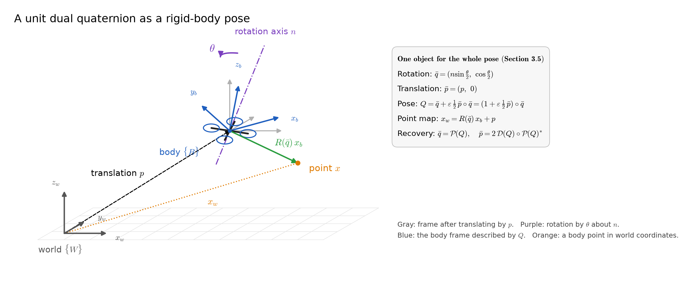
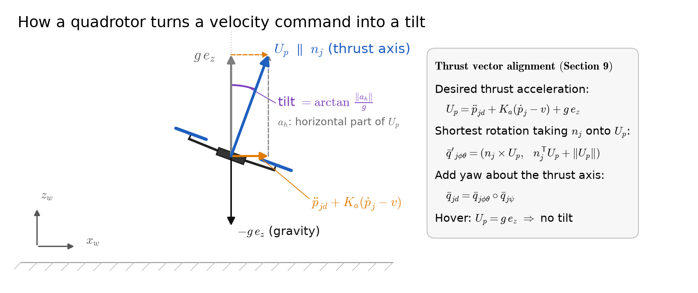
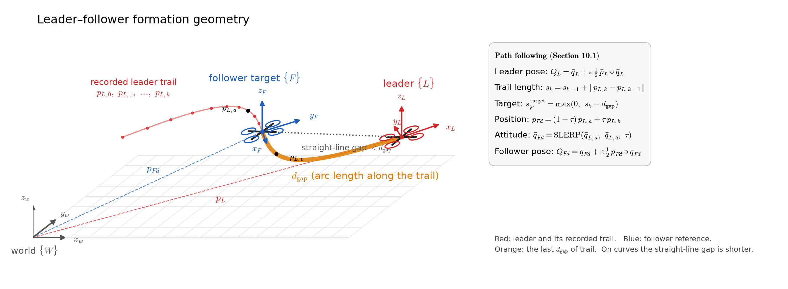

<p align="center">
  
</p>

# AB6: Introduction to Drones — Leader-Follower Formation of Two Quadrotors

**Desktop simulation UI:** Launch the interactive control panel with
`python scripts/run_ui.py`. The compact panel launches separate simulator
windows; it no longer attempts to embed native windows. PyBullet, MuJoCo and
Gazebo offer learned control with a trained response model. Kinematic mode
uses analytic control and a separate 3D reference plot. ArduPilot SITL is also
listed, with installation requirements described in [its guide](ardupilot/README.md).
Leader speed, follower gap, route radius, and flight altitude can be adjusted
while the simulation runs; applied values are displayed as they change.
See [desktop control details](docs/ui_controls.md). On Windows, Gazebo and ROS run inside WSL (Ubuntu 24.04 by
default); see [Gazebo setup](gazebo/README.md) for the required packages and
WSL settings.
Train first with `python scripts/train_data_driven.py --simulator pybullet`,
then run `python scripts/run_experiment.py --simulator pybullet --gui`.

**ArduPilot + Gazebo live demo:** see [setup and run instructions](ardupilot/README.md).
After one-time installation, `bash scripts/run_ardupilot.sh 60` launches two
ArduCopter SITLs, takes off, shows 60 seconds of leader–follower flight in
Gazebo with red/blue trails, then lands and stops. VS Code tasks also prompt
for duration. ArduPilot uses its own SITL-identified dynamics model inside a
dual-quaternion predictive controller (`--controller data_driven`, which
`learned` and the default `auto` select on ArduPilot); ArduPilot handles
low-level flight control. The same controller is available from the desktop UI.
See [ArduPilot data generation, training and validation](docs/data_driven.md#arducopter-sitl-data-driven-dual-quaternion-formation-control).

**Supporting course concepts:** See [the runnable guide](docs/course_concepts.md)
for B-spline and LERP/SLERP references, optional position Kalman filtering,
CVXPY path smoothing, hover stability/prediction, and Taylor/RK45 examples.
The original dual-quaternion controller and paper gain sets are retained.
Use `--simulator kinematic --controller analytic` for an ideal control-law demonstration without a
physics engine; the existing physics backends remain available.

**Follow the leader's actual route (new default):** the follower targets a point
0.8 m behind along the leader's recorded track, instead of a translated copy
of the trajectory. GUI runs draw red leader and blue follower trails.
Use `--follow_distance 0.8` to set the along-path gap, `--no-trails` to hide
lines, or `--follower_offset_mode world` for the original paper formation.
See [path-following details](docs/path_following.md).

Sections 3–9 retain the mathematical foundation and **original analytic baseline**.
Section 10 explains the current path-following reference; Section 20 derives the
**learned predictive controller**. Measured simulator results are collected at the end in Section 22. The project began as a simulation of
**dual quaternion-based control for a leader-follower formation of two quadrotors**, built to reproduce and explore the ideas from:

> H. N. Marciano, D. K. D. Villa, M. Sarcinelli-Filho, J. I. Giribet, *"Dual Quaternion-Based Control for a Leader-Follower Formation of Two Quadrotors,"* 2024 International Conference on Unmanned Aircraft Systems (ICUAS), Chania, Crete, Greece, June 4–7, 2024. [[1]](#23-references)

This document is written so that someone with **no prior background** in quaternions, dual numbers, or formation control can follow the math and the control design step by step, and then map each concept directly onto the code in this repository.

This README explains the mathematical concepts, their implementation, and the measured simulator results.

---

## Table of Contents

1. [Project Overview](#1-project-overview)
2. [Why Dual Quaternions?](#2-why-dual-quaternions)
3. [Mathematical Building Blocks](#3-mathematical-building-blocks)
   - 3.1 [Quaternions](#31-quaternions)
   - 3.2 [Quaternions as Rotations](#32-quaternions-as-rotations)
   - 3.3 [Dual Numbers](#33-dual-numbers)
   - 3.4 [Dual Quaternions](#34-dual-quaternions)
   - 3.5 [Dual Quaternions as Rigid-Body Pose](#35-dual-quaternions-as-rigid-body-pose)
4. [Vehicle Kinematics in Dual Quaternions](#4-vehicle-kinematics-in-dual-quaternions)
5. [Pose Error and the Control Objective](#5-pose-error-and-the-control-objective)
6. [The Kinematic Control Law](#6-the-kinematic-control-law)
7. [Why Tuning Is Hard: The Linearized Error Dynamics](#7-why-tuning-is-hard-the-linearized-error-dynamics)
8. [The Pole-Placement / Gain-Selection Method](#8-the-pole-placement--gain-selection-method)
9. [From Kinematics to Quadrotor Commands](#9-from-kinematics-to-quadrotor-commands)
10. [Leader-Follower Formation Law](#10-leader-follower-formation-law)
11. [Repository Structure](#11-repository-structure)
12. [Folder-by-Folder Walkthrough](#12-folder-by-folder-walkthrough)
    - 12.1 [dq_control/ — the math and control library](#121-dq_control--the-math-and-control-library)
    - 12.2 [simulators/ — the simulator bridge](#122-simulators--the-simulator-bridge)
    - 12.3 [scripts/ — command-line entry points](#123-scripts--command-line-entry-points)
    - 12.4 [utils/ — logging and metrics](#124-utils--logging-and-metrics)
    - 12.5 [configs/](#125-configs)
    - 12.6 [tests/](#126-tests)
13. [Installation & Setup](#13-installation--setup)
14. [How to Run an Experiment](#14-how-to-run-an-experiment)
15. [Visualizing Results and Metrics](#15-visualizing-results-and-metrics)
16. [Running the Tests](#16-running-the-tests)
17. [Design Notes: From Kinematic Twist to Motor Commands](#17-design-notes-from-kinematic-twist-to-motor-commands)
18. [Quick Reference](#18-quick-reference)
19. [Notation Glossary](#19-notation-glossary)
20. [Data-Driven Dual-Quaternion Control](#20-data-driven-dual-quaternion-control)
21. [Current Workflow and Course Concepts](#21-current-workflow-and-course-concepts)
22. [Results by Simulation](#22-results-by-simulation)
23. [References](#23-references)

---

## 1. Project Overview

Coordinating multiple drones is a core problem in robotics: think of a "leader" drone flying a planned path while one or more "follower" drones automatically maintain a fixed relative position and orientation with respect to it. This is the **leader-follower formation control** paradigm.

The reference paper [[1]](#23-references) tackles this problem for **two small quadrotors** using **dual quaternions** — a single mathematical object that represents *both* the orientation *and* the position of a rigid body at once. The paper's main contributions are:

- A **kinematic control law**, expressed purely in dual quaternions, that drives a vehicle's pose (position + attitude) to a desired, possibly time-varying, pose.
- A **systematic method for choosing controller gains** (instead of trial and error), based on analyzing the eigenvalues of the *linearized* closed-loop error dynamics.
- **Experimental validation** on two real Parrot Bebop 2 quadrotors flying a leader-follower Lemniscate ("figure-eight") trajectory, under three different gain-tuning strategies.

The original implementation reproduced the analytic control pipeline in simulation. The current project extends it into **simulator-trained predictive control**: recorded state–command–next-state transitions identify a response model, and an optimizer uses that model with dual-quaternion pose error to choose commands during flight. Both vehicles use this controller in learned mode.

The leader still follows a chosen mathematical reference. The follower instead targets an earlier pose on the leader's **measured path from the current flight**, normally 0.8 m behind by arc length. This is different from replaying a prerecorded training route. Red and blue trails display actual leader and follower movement.

| Component | Original baseline | Current implementation |
|---|---|---|
| High-level commands | Analytic proportional/integral law with selected gains | Learned response prediction plus bounded optimization |
| Training | No identification stage | Four simulator flights fit the response model; a fifth checks prediction |
| Pose mathematics | Dual quaternions | Preserved, including relative pose error |
| Follower reference | Spatially offset leader pose | Chronological leader-path history with interpolation |
| Interaction | Command-line experiment | CLI plus a live control panel and separate viewers |
| Validation | Analytic examples and tests | Model-prediction checks, controller comparisons, tracking logs and tests |

This is **data-driven high-level control**, not an entirely learned flight stack. Physics, low-level stabilization, pose kinematics, objective weights and some command constraints are designed. Training happens offline; flight commands are recalculated online. The paper's real-drone experiments are background evidence, not experiments performed by this repository.

---

## 2. Why Dual Quaternions?

Classical approaches represent a rigid body's **attitude** (orientation) with rotation matrices or quaternions, and its **position** separately as a 3D vector. This works, but it means:

- Position and orientation are updated and controlled with *different* mathematical tools.
- Combining/composing successive rigid-body transformations (rotate, then translate, then rotate again, etc.) requires juggling matrices and vectors together, which is computationally heavier and easier to get subtly wrong.

**Dual quaternions solve this by unifying position and orientation into a single 8-dimensional algebraic object.** Just as a unit quaternion compactly encodes a 3D rotation, a *unit dual quaternion* compactly encodes a full **rigid-body pose** (rotation **and** translation) — and, crucially, poses can be *composed* with a single quaternion-like product, exactly the way rotations compose for ordinary quaternions. This gives:

- A unified, singularity-free representation of pose (no gimbal lock, unlike Euler angles).
- Computationally efficient composition and inversion of transformations.
- A natural way to define a single **pose error** between "where the drone is" and "where it should be," combining position and attitude error into one quantity.

This is why the paper — and this project — builds the entire leader-follower controller on top of dual quaternion algebra.

> **Worked comparison — why "one object" actually matters in practice**
>
> Suppose you need to compose three successive rigid-body transforms (e.g., "world → leader body → camera mount → gimbal"). With the classical representation you carry a rotation matrix $`R \in SO(3)`$ **and** a translation vector $`t \in \mathbb{R}^{3}`$ for each transform. A point $`x`$ is mapped to $`R x + t`$, so applying $`(R_1, t_1)`$ and then $`(R_2, t_2)`$ requires the (easy to get wrong) rule
>
> ```math
> (R_2, t_2) \circ (R_1, t_1) = \left( R_2 R_1,\ R_2 t_1 + t_2 \right),
> \qquad
> (R, t)^{-1} = \left( R^{\mathsf T},\ -R^{\mathsf T} t \right)
> ```
>
> — a matrix-vector rule that is *different* from ordinary matrix multiplication. With unit dual quaternions, composing $`Q_2`$ after $`Q_1`$ is **exactly one dual-quaternion product**, $`Q_2 \circ Q_1`$, using the *same* multiplication rule used to compose pure rotations, and inverting a transform is just the conjugate, $`Q^{-1} = Q^{*}`$ (derived in Section 3.5). In `dq_control/dual_quaternion.py`, composition is `DualQuaternion.__mul__` and inversion is `DualQuaternion.conj()`.
>
> | | Rotation matrix + vector | Unit dual quaternion |
> |---|---|---|
> | Storage | $`9 + 3 = 12`$ numbers with $`6`$ constraints ($`R^{\mathsf T} R = I_3`$) | $`8`$ numbers with $`2`$ constraints ($`\lVert \bar{q} \rVert = 1`$ and dual-part orthogonality) |
> | Degrees of freedom | $`12 - 6 = 6`$ | $`8 - 2 = 6`$ |
> | Compose two poses | $`(R_2 R_1,\ R_2 t_1 + t_2)`$ — two different operations | $`Q_2 \circ Q_1`$ — one product |
> | Invert a pose | $`(R^{\mathsf T},\ -R^{\mathsf T} t)`$ | $`Q^{*}`$ |
> | Interpolate poses | Separate schemes for rotation (e.g. SLERP) and translation (linear) | Screw linear interpolation (ScLERP) handles both together |
> | Singularities | None for matrices; Euler angles have gimbal lock | None (like plain quaternions) |

---

## 3. Mathematical Building Blocks

To understand dual quaternions, we build up from ordinary quaternions and dual numbers. Throughout this README, an over-bar marks a quaternion, and the same letter without the bar denotes its vector part: $`\bar{q} = (q, q_0)`$.

### 3.1 Quaternions

Quaternions, introduced by Hamilton [[2]](#23-references), extend complex numbers to four dimensions. A quaternion is an ordered pair of a vector part and a scalar part:

```math
\bar{q} = (q,\ q_0), \qquad q \in \mathbb{R}^{3},\ q_0 \in \mathbb{R}
```

or, in the classical notation,

```math
\bar{q} = q_0 + q_1 i + q_2 j + q_3 k, \qquad i^{2} = j^{2} = k^{2} = ijk = -1
```

where $`q = (q_1, q_2, q_3)`$ is the **vector part** (the "imaginary" components) and $`q_0`$ is the **scalar part** (the "real" component).

Expanding the product of $`\bar{p} = (p, p_0)`$ and $`\bar{q} = (q, q_0)`$ with the rules for $`i`$, $`j`$ and $`k`$ gives the **Hamilton product**:

```math
\bar{p} \circ \bar{q} = \left( p_0\, q + q_0\, p + p \times q,\ \ p_0 q_0 - p^{\mathsf T} q \right)
```

The same product can be written in matrix form:

```math
\bar{p} \circ \bar{q} =
\begin{bmatrix}
S(p) + p_0 I_3 & p \\
-p^{\mathsf T} & p_0
\end{bmatrix}
\begin{bmatrix}
q \\
q_0
\end{bmatrix},
\qquad
S(p) =
\begin{bmatrix}
0 & -p_3 & p_2 \\
p_3 & 0 & -p_1 \\
-p_2 & p_1 & 0
\end{bmatrix}
```

where $`S(\cdot)`$ is the **skew-symmetric matrix** that reproduces the cross product, $`S(p)\, w = p \times w`$.

Quaternion multiplication is **not commutative**. Only the cross product changes sign when the factors are swapped, so

```math
\bar{p} \circ \bar{q} - \bar{q} \circ \bar{p} = \left( 2\, p \times q,\ 0 \right)
```

Order matters, just as it does for 3D rotations.

Other key operations:

```math
\bar{q}^{*} = (-q,\ q_0), \qquad
\bar{q} \circ \bar{q}^{*} = \bar{q}^{*} \circ \bar{q} = \left(0,\ \lVert \bar{q} \rVert^{2}\right), \qquad
\lVert \bar{q} \rVert^{2} = q^{\mathsf T} q + q_0^{2}, \qquad
(\bar{p} \circ \bar{q})^{*} = \bar{q}^{*} \circ \bar{p}^{*}
```

A vector $`a \in \mathbb{R}^{3}`$ is embedded as the **pure quaternion** $`\bar{a} = \mathrm{pure}(a) = (a, 0)`$, whose scalar part is zero.

### 3.2 Quaternions as Rotations

A **unit quaternion** ($`\lVert \bar{q} \rVert = 1`$) represents a rotation, just as a unit complex number represents a rotation in the plane. A rotation by angle $`\theta`$ about the unit axis $`n`$ is

```math
\bar{q} = \left( n \sin\frac{\theta}{2},\ \cos\frac{\theta}{2} \right), \qquad \lVert n \rVert = 1
```

If $`\bar{q}`$ rotates the body frame $`b`$ into the world (inertial) frame $`w`$, a vector expressed in the body frame is transformed by the **sandwich product**:

```math
\bar{p}_{w} = \bar{q} \circ \bar{p}_{b} \circ \bar{q}^{*}
```

Expanding the sandwich product gives the equivalent rotation matrix $`R(\bar{q})`$:

```math
p_{w} = R(\bar{q})\, p_{b}, \qquad
R(\bar{q}) = \left(q_0^{2} - q^{\mathsf T} q\right) I_3 + 2\, q\, q^{\mathsf T} + 2\, q_0\, S(q)
```

Substituting the axis-angle form gives Rodrigues' rotation formula, which confirms that the sandwich product rotates $`v`$ by $`\theta`$ about $`n`$:

```math
R(\bar{q})\, v = v \cos\theta + (n \times v) \sin\theta + n \left(n^{\mathsf T} v\right)(1 - \cos\theta)
```

The angle appears as $`\theta/2`$ because $`\bar{q}`$ is applied twice, once on each side of the vector. For the same reason, $`\bar{q}`$ and $`-\bar{q}`$ represent the *same* rotation: the two signs cancel in the sandwich product. This "double cover" is a well-known and harmless property of quaternions.

If the body rotates with angular velocity $`\omega`$, expressed in the body frame, the quaternion evolves according to

```math
\dot{\bar{q}} = \frac{1}{2}\, \bar{q} \circ \bar{\omega}, \qquad \bar{\omega} = (\omega,\ 0)
```

This single differential equation replaces the more cumbersome update equations needed for rotation matrices or Euler angles. It has no singularities, and it preserves the unit norm because $`\bar{q}^{*} \circ \dot{\bar{q}} = \tfrac{1}{2} \lVert \bar{q} \rVert^{2}\, \bar{\omega}`$ has zero scalar part.

### 3.3 Dual Numbers

Before combining quaternions with position, we need one more ingredient: **dual numbers**, introduced by Clifford [[3]](#23-references) and developed for rigid-body motion by Study [[4]](#23-references). A dual number has the form

```math
\hat{\alpha} = a + \varepsilon\, b, \qquad a, b \in \mathbb{R}
```

where $`\varepsilon`$ is the **dual unit**, defined by

```math
\varepsilon \neq 0, \qquad \varepsilon^{2} = 0
```

This is similar to how $`i^{2} = -1`$ defines complex numbers, except that squaring the special symbol gives **zero**. The dual unit is *not* "a small number close to zero"; it is an algebraic element. For example, the matrix

```math
\varepsilon \equiv \begin{bmatrix} 0 & 1 \\ 0 & 0 \end{bmatrix}
```

satisfies $`\varepsilon \neq 0`$ and $`\varepsilon^{2} = 0`$.

Dual numbers add component-wise and multiply using $`\varepsilon^{2} = 0`$:

```math
(a + \varepsilon\, b)(c + \varepsilon\, d) = ac + \varepsilon\,(ad + bc)
```

Here $`a`$ is the **principal** (nominal) part and $`b`$ is the **dual** part, a first-order term that rides along with it. A Taylor expansion shows this exactly: for any smooth function $`f`$,

```math
f(a + \varepsilon\, b) = f(a) + \varepsilon\, b\, f'(a)
```

because every term containing $`\varepsilon^{2}`$ vanishes. The same mechanism lets a dual quaternion carry *position* alongside *orientation*.

### 3.4 Dual Quaternions

A **dual quaternion** applies the dual-number construction to quaternions instead of real numbers:

```math
Q = \bar{r} + \varepsilon\, \bar{s}, \qquad \bar{r}, \bar{s} \in \mathbb{H}
```

where $`\mathbb{H}`$ is the set of quaternions. $`Q`$ has 8 real components, 4 from each part. We call $`\mathcal{P}(Q) = \bar{r}`$ the **principal part** and $`\mathcal{D}(Q) = \bar{s}`$ the **dual part**.

Sum, product and conjugation follow from the quaternion operations and $`\varepsilon^{2} = 0`$:

```math
Q_1 \circ Q_2 = \bar{r}_1 \circ \bar{r}_2 + \varepsilon \left( \bar{r}_1 \circ \bar{s}_2 + \bar{s}_1 \circ \bar{r}_2 \right), \qquad
Q^{*} = \mathcal{P}(Q)^{*} + \varepsilon\, \mathcal{D}(Q)^{*}
```

The order of every quaternion product is preserved because quaternion multiplication is not commutative.

### 3.5 Dual Quaternions as Rigid-Body Pose

Just as a unit quaternion represents a rotation, a **unit dual quaternion** represents a full rigid-body **pose** (rotation and translation together). Using the product rule from Section 3.4,

```math
Q \circ Q^{*} = \bar{r} \circ \bar{r}^{*} + \varepsilon \left( \bar{r} \circ \bar{s}^{*} + \bar{s} \circ \bar{r}^{*} \right) = 1
\quad \Longleftrightarrow \quad
\lVert \bar{r} \rVert = 1 \quad \text{and} \quad r_0 s_0 + r^{\mathsf T} s = 0
```

The two constraints leave $`8 - 2 = 6`$ degrees of freedom, exactly those of a rigid body. Every dual part that satisfies the orthogonality condition can be written in terms of a position $`p \in \mathbb{R}^{3}`$, so with attitude $`\bar{q} = \mathcal{P}(Q)`$:

```math
\mathcal{D}(Q) = \frac{1}{2}\, \bar{p} \circ \bar{q}, \qquad \bar{p} = (p,\ 0)
```

Given any unit dual quaternion $`Q`$, the attitude and position are recovered with

```math
\bar{q} = \mathcal{P}(Q), \qquad \bar{p} = 2\, \mathcal{D}(Q) \circ \mathcal{P}(Q)^{*}
```

So a single object

```math
Q = \bar{q} + \varepsilon\, \frac{1}{2}\, \bar{p} \circ \bar{q}
```

describes where the drone is and how it is oriented. It is the product of a translation $`1 + \varepsilon \tfrac{1}{2} \bar{p}`$ and a rotation $`\bar{q}`$. Multiplying two poses composes both parts correctly:

```math
Q_2 \circ Q_1 = \bar{q}_2 \circ \bar{q}_1 + \varepsilon\, \frac{1}{2} \left( \bar{p}_2 + \bar{q}_2 \circ \bar{p}_1 \circ \bar{q}_2^{*} \right) \circ \bar{q}_2 \circ \bar{q}_1
```

that is, attitude $`\bar{q}_2 \circ \bar{q}_1`$ and position $`p_2 + R(\bar{q}_2)\, p_1`$. The conjugate $`Q^{*}`$ has attitude $`\bar{q}^{*}`$ and position $`-R(\bar{q})^{\mathsf T} p`$, so it is the inverse pose. These are the classical rules from Section 2, obtained from one product.

<p align="center"></p>

<p align="center"><em>Figure 1. A unit dual quaternion as a rigid-body pose: a translation followed by a rotation about an axis.</em></p>

---

## 4. Vehicle Kinematics in Dual Quaternions

The **twist** (angular and linear velocity) of a vehicle is also packaged into a dual quaternion. With $`\bar{q} = \mathcal{P}(Q)`$, body-frame angular velocity $`\omega`$ and world-frame linear velocity $`v`$:

```math
\Omega(\bar{\omega}, \bar{v}) = \bar{\omega} + \varepsilon\, \bar{q}^{*} \circ \bar{v} \circ \bar{q}, \qquad \bar{\omega} = (\omega,\ 0),\ \ \bar{v} = (v,\ 0)
```

The pose then evolves according to a single compact equation:

```math
\dot{Q} = \frac{1}{2}\, Q \circ \Omega(\bar{\omega}, \bar{v})
```

This is the dual-quaternion analogue of $`\dot{\bar{q}} = \tfrac{1}{2}\, \bar{q} \circ \bar{\omega}`$ for pure rotation. It propagates position and attitude together. Expanding its dual part with $`\mathcal{D}(Q) = \tfrac{1}{2}\, \bar{p} \circ \bar{q}`$ gives $`\dot{p} = v`$. The simulation integrates this equation forward in time to turn velocity commands into target poses.

---

## 5. Pose Error and the Control Objective

Let $`Q`$ be the vehicle's **current** pose and $`Q_d`$ the **desired** pose. The **pose error** is a single dual quaternion:

```math
\delta Q = Q_d^{*} \circ Q = \delta\bar{q} + \varepsilon\, \frac{1}{2}\, \delta\bar{p}_b \circ \delta\bar{q}
```

where

```math
\delta\bar{q} = \bar{q}_d^{*} \circ \bar{q} = (\delta q,\ \delta q_0), \qquad
\delta p = p - p_d, \qquad
\delta\bar{p}_b = \bar{q}_d^{*} \circ \delta\bar{p} \circ \bar{q}_d
```

- $`\delta\bar{q}`$ is the **attitude error**, with vector part $`\delta q`$ and scalar part $`\delta q_0`$;
- $`\delta p`$ is the raw **position error** in the world frame;
- $`\delta p_b`$ is that position error expressed **in the desired body frame**, the natural frame in which to regulate it.

The **control goal** is to drive $`\delta Q \to 1`$, the identity dual quaternion. Equivalently, $`\delta q \to 0`$ and $`\delta p \to 0`$, so the vehicle's actual pose converges to the desired pose. Both position and attitude errors are captured by this one object.

---

## 6. The Kinematic Control Law

> **Analytic baseline:** this section preserves the original derivation. Learned mode uses the predictive formulation in Section 20; these gain-based stability arguments do not prove stability of the learned controller.

The controller computes the **commanded twist** $`(\bar{\omega}, \bar{v})`$ from the pose error. It uses six gain matrices:

```math
K_{\omega,p},\ K_{v,p},\ K_{\omega,i},\ K_{v,i},\ K_{\eta},\ K_{\xi} \in \mathbb{R}^{3 \times 3}
```

For the integral-controller analysis, the gain matrices are symmetric and negative definite. The proportional-only preset disables the integral terms with zero matrices and is a separate special case. In the subscripts, $`p`$ means proportional and $`i`$ means integral. $`\mathrm{pure}(\cdot)`$ is the pure-quaternion embedding from Section 3.1.

### Angular velocity command

```math
\bar{\omega} = \delta\bar{q}^{*} \circ \bar{\omega}_d \circ \delta\bar{q} + \mathrm{pure}\left[ \mathrm{sgn}(\delta q_0) \left( K_{\omega,p}\, \delta q + \eta_0\, K_{\omega,i}\, \eta \right) \right]
```

Here:

- $`\bar{\omega}`$ is the commanded body-frame angular velocity, written as a pure quaternion;
- $`\bar{\omega}_d`$ is the desired angular velocity;
- $`\delta q`$ and $`\delta q_0`$ are the vector and scalar parts of the attitude error $`\delta\bar{q}`$;
- $`\bar{\eta} = (\eta, \eta_0)`$ is the attitude integral state, a unit quaternion that starts at the identity.

The implementation uses $`\mathrm{sgn}(0) = 1`$. The factor $`\mathrm{sgn}(\delta q_0)`$ selects the shorter rotation, because $`\delta\bar{q}`$ and $`-\delta\bar{q}`$ describe the same attitude error.

### Linear velocity command

```math
v = v_d + R(\bar{q}_d) \left( K_{v,p}\, \delta p_b + K_{v,i}\, \xi \right)
```

Here $`v, v_d \in \mathbb{R}^{3}`$ are world-frame velocities, $`R(\bar{q}_d)`$ is the rotation matrix of the desired attitude (Section 3.2), and $`\delta p_b`$ is the position error in the desired body frame. Their pure-quaternion forms are $`\bar{v} = (v, 0)`$ and $`\bar{v}_d = (v_d, 0)`$.

### Attitude integral state

```math
\dot{\bar{\eta}} = \frac{1}{2}\, \bar{\eta} \circ \mathrm{pure}\left[ -\lvert \delta q_0 \rvert\, K_{\omega,i}\, \delta q + \mathrm{sgn}(\eta_0)\, K_{\eta}\, \eta \right]
```

The $`K_{\eta}\, \eta`$ term is a **forgetting (leakage) term** that prevents the integral state from growing without bound.

### Position integral state

```math
\dot{\xi} = -K_{v,i}\, \delta p_b + K_{\xi}\, \xi
```

The first term accumulates the position error, while $`K_{\xi}\, \xi`$ provides the corresponding forgetting mechanism.

### Interpretation

- The **feedforward** terms $`\bar{\omega}_d`$ and $`v_d`$ provide the velocity required by the desired trajectory.
- The **proportional** terms $`K_{\omega,p}\, \delta q`$ and $`K_{v,p}\, \delta p_b`$ respond to the instantaneous pose error.
- The **integral** terms involving $`\eta`$ and $`\xi`$ accumulate persistent tracking errors.
- The $`K_{\eta}`$ and $`K_{\xi}`$ terms prevent excessive accumulation of the integral states.

The closed-loop error states converge toward the equilibrium

```math
\delta\bar{q} \rightarrow \bar{1}, \qquad \delta p \rightarrow 0, \qquad \eta \rightarrow 0, \qquad \xi \rightarrow 0
```

where $`\bar{1} = (0, 1)`$ is the **identity quaternion**, representing zero attitude error.

---

## 7. Why Tuning Is Hard: The Linearized Error Dynamics

> **Analytic baseline:** this section preserves the original derivation. Learned mode uses the predictive formulation in Section 20; these gain-based stability arguments do not prove stability of the learned controller.

Adding the integral states $`\eta`$ and $`\xi`$ improves steady-state tracking, but it also introduces additional gain matrices. For the attitude subsystem, the relevant gains are $`K_{\omega,p}`$, $`K_{\omega,i}`$ and $`K_{\eta}`$.

Near the equilibrium $`\delta\bar{q} = \bar{\eta} = \bar{1}`$ (so $`\delta q_0 \approx \eta_0 \approx 1`$), the attitude-error dynamics linearize to

```math
\begin{bmatrix} \dot{\delta q} \\ \dot{\eta} \end{bmatrix}
= M_{\omega}
\begin{bmatrix} \delta q \\ \eta \end{bmatrix},
\qquad
M_{\omega} = \frac{1}{2}
\begin{bmatrix}
K_{\omega,p} & K_{\omega,i} \\
-K_{\omega,i} & K_{\eta}
\end{bmatrix}
\in \mathbb{R}^{6 \times 6}
```

The factor $`\tfrac{1}{2}`$ comes from the quaternion kinematics $`\dot{\bar{q}} = \tfrac{1}{2}\, \bar{q} \circ \bar{\omega}`$. For a constant desired attitude, the position-error dynamics follow directly from Section 6, without that factor:

```math
\begin{bmatrix} \dot{\delta p}_b \\ \dot{\xi} \end{bmatrix}
= M_{v}
\begin{bmatrix} \delta p_b \\ \xi \end{bmatrix},
\qquad
M_{v} =
\begin{bmatrix}
K_{v,p} & K_{v,i} \\
-K_{v,i} & K_{\xi}
\end{bmatrix}
\in \mathbb{R}^{6 \times 6}
```

For a linear system $`\dot{x} = M x`$, the eigenvalues $`\lambda`$ of $`M`$ determine the local behavior:

| Eigenvalue | Behavior of the corresponding mode |
|---|---|
| $`\lambda`$ real, $`\lambda < 0`$ | decays exponentially, without oscillation |
| $`\lambda`$ complex, $`\mathrm{Re}\lambda < 0`$ | decays while oscillating |
| $`\mathrm{Re}\lambda > 0`$ | grows: unstable |

Selecting the controller gains is therefore a structured **pole-placement problem**. The difficulty is that $`M_{\omega}`$ and $`M_{v}`$ are block matrices: their eigenvalues are not, in general, the eigenvalues of the individual blocks. Making each gain matrix negative definite does not by itself determine the eigenvalues of the complete matrix.

---

## 8. The Pole-Placement / Gain-Selection Method

> **Analytic baseline:** this section preserves the original derivation. Learned mode uses the predictive formulation in Section 20; these gain-based stability arguments do not prove stability of the learned controller.

### Spectral structure

Define the indefinite matrix and inner product

```math
H =
\begin{bmatrix}
I_3 & 0_{3 \times 3} \\
0_{3 \times 3} & -I_3
\end{bmatrix}
\in \mathbb{R}^{6 \times 6},
\qquad
[x, y]_H = x^{\mathsf T} H y
```

Because the gain matrices are symmetric, $`M_{\omega}`$ satisfies

```math
H M_{\omega} = M_{\omega}^{\mathsf T} H
```

so $`M_{\omega}`$ is **$`H`$-self-adjoint**. The reference paper uses this structure to bound the eigenvalues of $`M_{\omega}`$ in terms of the coupling quantities

```math
\left\lVert K_{\omega,p}^{-1} K_{\omega,i} \right\rVert
\qquad \text{and} \qquad
\left\lVert K_{\eta}^{-1} K_{\omega,i} \right\rVert
```

If the coupling introduced by $`K_{\omega,i}`$ is small compared with the separation between the spectra of $`\tfrac{1}{2} K_{\omega,p}`$ and $`\tfrac{1}{2} K_{\eta}`$, all eigenvalues of $`M_{\omega}`$ are real and negative, which gives a locally exponentially convergent, non-oscillatory response. If the coupling is too strong, complex-conjugate eigenvalues with negative real parts appear, which gives a damped oscillatory response. The same reasoning applies to $`M_{v}`$.

### Exact condition for diagonal gains

All gain matrices in `dq_control/gains.py` are diagonal. Then $`M_{\omega}`$ splits into three independent $`2 \times 2`$ blocks, one per axis $`k \in \{x, y, z\}`$:

```math
M_{\omega}^{(k)} = \frac{1}{2}
\begin{bmatrix}
a_k & c_k \\
-c_k & d_k
\end{bmatrix},
\qquad
a_k = \left[K_{\omega,p}\right]_{kk},\ \
c_k = \left[K_{\omega,i}\right]_{kk},\ \
d_k = \left[K_{\eta}\right]_{kk}
```

Its eigenvalues follow from the characteristic polynomial:

```math
\lambda^{2} - \frac{a_k + d_k}{2}\, \lambda + \frac{a_k d_k + c_k^{2}}{4} = 0
\quad \Longrightarrow \quad
\lambda = \frac{(a_k + d_k) \pm \sqrt{(a_k - d_k)^{2} - 4 c_k^{2}}}{4}
```

Since $`a_k, d_k < 0`$, both eigenvalues have negative real parts, and they are real exactly when

```math
\lvert c_k \rvert \le \frac{\lvert a_k - d_k \rvert}{2}
```

The position blocks of $`M_{v}`$ obey the same condition with $`K_{v,p}`$, $`K_{v,i}`$ and $`K_{\xi}`$ (the factor $`\tfrac{1}{2}`$ scales the eigenvalues but does not change whether they are real). For the leader's $`x`$/$`y`$ axes:

| Gain set | Attitude: $`\lvert c_k \rvert`$ vs. $`\lvert a_k - d_k \rvert / 2`$ | Position: same test | Eigenvalues |
|---|---|---|---|
| `proportional` | $`0`$ vs. $`0.75`$ | $`0`$ vs. $`0.90`$ | real (integral terms disabled) |
| `complex_eig` | $`0.80 > 0.65`$ | $`0.80 > 0.75`$ | complex |
| `real_eig` | $`0.20 \le 0.715`$ | $`0.40 \le 0.88`$ | real |

### Practical gain-selection procedure

**Step 1.** Select the proportional gains $`K_{\omega,p}`$ and $`K_{v,p}`$.

**Step 2.** Select the integral-related gains $`K_{\omega,i}`$, $`K_{\eta}`$, $`K_{v,i}`$ and $`K_{\xi}`$.

**Step 3.** Construct the linearized matrices $`M_{\omega}`$ and $`M_{v}`$ from Section 7.

**Step 4.** Compute their eigenvalues:

```math
\lambda\left(M_{\omega}\right), \qquad \lambda\left(M_{v}\right)
```

**Step 5.** Keep only gains that produce eigenvalues with negative real parts. When a smooth, non-oscillatory response is desired, choose gains that keep all eigenvalues real and negative (for diagonal gains, the inequality above).

---

## 9. From Kinematics to Quadrotor Commands

> **Analytic baseline:** this section preserves the original derivation. Learned mode uses the predictive formulation in Section 20; these gain-based stability arguments do not prove stability of the learned controller.

The kinematic controller produces the desired twist $`(\bar{\omega}, \bar{v})`$. A quadrotor cannot directly generate an arbitrary three-dimensional velocity; its motion is produced through thrust and attitude control. In the reference paper, the Parrot Bebop 2 accepts roll, pitch, vertical-velocity and yaw-rate commands:

```math
u_{\phi}, \qquad u_{\theta}, \qquad u_{\dot{z}}, \qquad u_{\dot{\psi}}
```

Horizontal motion requires an additional mapping because a quadrotor generates horizontal acceleration by **tilting its thrust vector**. This repository implements the final stage differently for each simulator backend (see Section 17).

### Desired acceleration

For vehicle $`j`$, the desired thrust acceleration combines the reference acceleration, velocity feedback toward the kinematic command $`v`$, and gravity compensation:

```math
U_p = \ddot{p}_{jd} + K_a \left( \dot{p}_j - v \right) + g\, e_z
```

Here:

- $`p_{jd}`$ is the desired position of vehicle $`j`$, and $`\ddot{p}_{jd}`$ its desired acceleration;
- $`\dot{p}_j`$ is the actual velocity;
- $`v`$ is the velocity generated by the kinematic controller;
- $`K_a`$ is the acceleration-level feedback gain, negative definite like the gains in Section 6, so that the term pushes $`\dot{p}_j`$ toward $`v`$;
- $`g = 9.81\ \mathrm{m/s^{2}}`$ and $`e_z = (0, 0, 1)^{\mathsf T}`$ is the world vertical.

### Thrust-vector alignment

Let $`n_j = e_z`$ be the thrust axis of vehicle $`j`$ in its body frame. The shortest rotation that aligns $`n_j`$ with $`U_p`$ is

```math
\bar{q}'_{j\phi\theta} = \left( n_j \times U_p,\ \ n_j^{\mathsf T} U_p + \lVert U_p \rVert \right),
\qquad
\bar{q}_{j\phi\theta} = \frac{\bar{q}'_{j\phi\theta}}{\left\lVert \bar{q}'_{j\phi\theta} \right\rVert}
```

It is well defined whenever $`U_p`$ is not directed straight down. At hover, $`U_p = g\, e_z`$ and $`\bar{q}_{j\phi\theta}`$ is the identity: no tilt.

<p align="center"></p>

<p align="center"><em>Figure 2. Thrust-vector alignment: the drone tilts until its thrust axis points along the desired acceleration.</em></p>

### Yaw composition

The roll-pitch rotation does not determine yaw, so yaw is specified separately by the desired yaw quaternion $`\bar{q}_{j\psi}`$. Because $`\bar{q}_{j\psi}`$ rotates about $`n_j`$, it does not change the thrust direction, and the complete desired attitude is

```math
\bar{q}_{jd} = \bar{q}_{j\phi\theta} \circ \bar{q}_{j\psi}
```

The complete control structure is therefore:

```text
Pose error → Kinematic controller → (ω̄, v̄) → Acceleration/attitude mapping → Quadrotor commands
```

The block diagram below shows this layering as implemented around `simulators/leader_follower.py` (see also Section 17):

<p align="center"></p>

<p align="center"><em>Figure 3. Control cascade from pose error to motor commands.</em></p>

---

## 10. Leader-Follower Formation Law

The formation controller defines the desired pose that each vehicle should track. The subscript $`j \in \{L, F\}`$ denotes the leader $`L`$ or the follower $`F`$.

### 10.1 Current default: follow the leader's measured route

Let the measured leader positions be $`p_{L,0}, p_{L,1}, \ldots, p_{L,k}`$. The accumulated distance along the recorded trail is

```math
s_k = s_{k-1} + \left\lVert p_{L,k} - p_{L,k-1} \right\rVert_2
```

For the following distance $`d_{\mathrm{gap}}`$, the desired trail coordinate is

```math
s_F^{\mathrm{target}} = \max\left(0,\ s_k - d_{\mathrm{gap}}\right)
```

Choose the chronologically neighboring samples $`a`$ and $`b`$ whose distances bracket that target ($`s_a \le s_F^{\mathrm{target}} \le s_b`$). Their interpolation fraction and the follower's desired position are

```math
\tau = \frac{s_F^{\mathrm{target}} - s_a}{s_b - s_a},
\qquad
p_{Fd} = (1 - \tau)\, p_{L,a} + \tau\, p_{L,b}
```

Orientation is interpolated on the unit-quaternion sphere by spherical linear interpolation (SLERP) [[5]](#23-references):

```math
\bar{q}_{Fd} = \mathrm{SLERP}\left(\bar{q}_{L,a},\ \bar{q}_{L,b},\ \tau\right)
= \frac{\sin\left((1 - \tau)\Theta\right)}{\sin\Theta}\, \bar{q}_{L,a} + \frac{\sin(\tau\Theta)}{\sin\Theta}\, \bar{q}_{L,b},
\qquad
\cos\Theta = \bar{q}_{L,a}^{\mathsf T}\, \bar{q}_{L,b}
```

where the sign of $`\bar{q}_{L,b}`$ is flipped if necessary so that $`\cos\Theta \ge 0`$ (shortest arc). The follower's desired dual quaternion is then

```math
Q_{Fd} = \bar{q}_{Fd} + \varepsilon\, \frac{1}{2}\, \bar{p}_{Fd} \circ \bar{q}_{Fd}
```

This reference is passed to the same selected controller as the leader's reference. At a figure-eight crossing, the chronological history determines which segment to follow; the code does not jump to the nearest unrelated crossing segment.

<p align="center"></p>

<p align="center"><em>Figure 4. Path-following formation: the follower target lies a fixed arc length back along the leader's recorded trail.</em></p>

`dq_control/path_following.py` implements this behavior. The initial history contains a seed segment between the two starting positions. Live-control runs retain extra history, so increasing the gap can recover older points. Until sufficient history exists, the target is limited to the available segment. The gap $`d_{\mathrm{gap}}`$ is a reference arc length, not a guaranteed physical separation or collision avoidance: on tight curves the straight-line distance between the drones is shorter than $`d_{\mathrm{gap}}`$.

### 10.2 Original offset formulation

The leader equations below remain applicable. The fixed-offset follower is retained for the explicit `world` (and `body`) formation modes; it is no longer the default follower reference.

#### Leader

The leader follows a predefined position trajectory $`p_{Ld}(t)`$ and desired attitude $`\bar{q}_{Ld}(t)`$. Its desired pose is the dual quaternion

```math
Q_{Ld}(t) = \bar{q}_{Ld}(t) + \varepsilon\, \frac{1}{2}\, \bar{p}_{Ld}(t) \circ \bar{q}_{Ld}(t)
```

which represents the desired position and orientation of the leader simultaneously.

#### Follower

The follower's desired position is generated from the leader's measured position and a formation offset:

```math
p_{Fd}(t) = p_L(t) + f(t)
```

where $`p_L(t)`$ is the measured leader position, $`f(t)`$ is the desired formation offset and $`p_{Fd}(t)`$ is the resulting desired follower position. In `world` mode, $`f = (x_{\mathrm{off}}, 0, 0)^{\mathsf T}`$ with $`x_{\mathrm{off}} = 1.85\ \mathrm{m}`$ by default. The follower's desired attitude can be specified independently or chosen to follow the leader:

```math
\bar{q}_{Fd}(t) = \bar{q}_L(t)
```

### 10.3 Effect of measurement noise

Because the follower's reference is built from the leader's *measured* state, measurement noise is transferred to the follower. Write the measured leader position as

```math
\tilde{p}_L(t) = p_L(t) + n(t)
```

In the offset formulation, the noise enters the follower reference unchanged:

```math
\tilde{p}_{Fd}(t) = \tilde{p}_L(t) + f(t) = p_{Fd}(t) + n(t)
```

If a velocity is then obtained by numerical differentiation with sample time $`\Delta t`$, independent noise of standard deviation $`\sigma`$ per axis is amplified to approximately

```math
\sigma_v \approx \frac{\sqrt{2}\, \sigma}{\Delta t}
```

which explains why the follower's trajectory can appear noisier than the leader's.

In the default path-following mode, noise has an additional effect: every noisy step adds length to the recorded trail, so $`s_k`$ grows faster than the true distance travelled. The target $`s_k - d_{\mathrm{gap}}`$ then lies closer to the leader than intended, and the physical gap shrinks. When `--position_noise_std` is non-zero, enable `--kalman` (a constant-velocity Kalman filter [[6]](#23-references)) so that the trail is recorded from filtered positions.

### 10.4 Pose error for each vehicle

Each vehicle runs its own copy of the controller. In the analytic convention of Section 5, the pose errors are

```math
\delta Q_j = Q_{jd}^{*} \circ Q_j, \qquad j \in \{L, F\},
\qquad \text{that is,} \qquad
\delta Q_L = Q_{Ld}^{*} \circ Q_L, \quad \delta Q_F = Q_{Fd}^{*} \circ Q_F
```

The learned controller uses the current-frame convention $`Q_j^{*} \circ Q_{jd}`$ instead (Section 20.3). The overall leader-follower structure is:

```text
Leader trajectory → Leader desired pose → Leader controller → Leader motion
```

```text
Leader measured pose → Follower reference (path history or offset) → Follower desired pose → Follower controller → Follower motion
```

---

## 11. Repository Structure

```text
dq_control/
  quaternion.py, dual_quaternion.py   # pose algebra and integration
  controller.py, gains.py            # analytic baseline
  learned_control.py                 # identification and predictive controller
  data_driven.py                     # ArduPilot predictive controller
  path_following.py                  # measured leader-history reference
  trajectories.py, course_trajectories.py
  estimation.py, optimization.py     # optional filtering and path smoothing
  course_analysis.py                 # hover linearization, Taylor and RK45 examples
simulators/
  base.py, registry.py                # common state/command interface
  leader_follower.py                  # shared experiment loop and live controls
  gym_pybullet.py, mujoco.py, gazebo.py, kinematic.py, ardupilot.py
  low_level.py, trails.py             # Gazebo low-level control, trail drawing
  gazebo_wsl_worker.py                # Windows-to-WSL protocol
scripts/
  run_ui.py, run_experiment.py        # desktop and CLI entry points
  train_data_driven.py                # collection, fitting and evaluation
  plot_results.py, analyze_course_concepts.py
  make_readme_figures.py              # regenerates the README schematic figures
  setup_simulators.py                 # clones external simulator repositories
  setup_ardupilot.sh, check_ardupilot.py, run_ardupilot.sh
  collect_ardupilot_data.py, train_ardupilot_model.py, validate_ardupilot_model.py
ardupilot/                           # ArduPilot world, GUI configuration and guide
gazebo/                              # Gazebo models, worlds, bridge configuration and guide
docs/                                # detailed guides (data-driven control, UI, path following)
models/                              # saved response matrices and metadata
data/                                # identification and evaluation recordings
configs/                             # reference trajectory definitions
results/                             # timestamped experiment logs
assets/                              # retained mathematical illustrations
utils/                               # logging and metrics
tests/                               # algebra, control and integration checks
```

## 12. Folder-by-Folder Walkthrough

### 12.1 `dq_control/` — the math and control library

- `quaternion.py` and `dual_quaternion.py` implement the algebra, pose conversion and integration explained above.
- `controller.py` and `gains.py` retain the analytic baseline and the paper-inspired gain sets.
- `learned_control.py` defines state features, ridge fitting, saved-model validation, dual-quaternion error and bounded predictive command selection.
- `path_following.py` records measured leader poses and constructs the follower's delayed-by-distance target.
- `course_trajectories.py` supplies B-spline and interpolated-pose references. `estimation.py` supplies optional position Kalman filtering; `optimization.py` smooths B-spline control points with CVXPY.

### 12.2 `simulators/` — the simulator bridge

`LeaderFollowerSimulation` reads both drone states, builds their desired poses, calls their controllers, integrates each twist into a one-step target, applies commands, and logs actual motion. `DroneState` contains position, attitude, world velocity and body angular velocity. `VehicleCommand` supplies position/orientation targets plus linear and angular velocity commands.

| Backend | How commands produce movement | Viewer |
|---|---|---|
| PyBullet [[8]](#23-references) | gym-pybullet-drones low-level controller and motor dynamics | Native PyBullet window |
| MuJoCo [[9]](#23-references) | Bounded world-force translation, roll/pitch stabilization and bounded yaw tracking | Native MuJoCo window |
| Gazebo [[10]](#23-references), [[11]](#23-references) | ROS 2 actuator messages, motor model and quadrotor physics | Gazebo / WSLg window |
| Kinematic | Direct ideal twist integration, without motors or forces | Separate 3D reference plot in UI mode |

MuJoCo is not equivalent to the rotor-actuated backends. Cross-simulator numbers must not be interpreted as rankings of controller quality on identical physical systems.

### 12.3 `scripts/` — command-line entry points

`train_data_driven.py` collects four training flights and a separate validation flight, fits one backend-specific model, and compares analytic/learned control on additional trajectories. `run_experiment.py` loads a model in learned mode and saves a completed run. `run_ui.py` supports long-running interactive sessions; its callback path does not save the full CLI experiment log. Use the CLI when collecting results for a report.

### 12.4 `utils/` — logging and metrics

`logger.py` saves and loads NumPy archives. `metrics.py` supports the plotting script's MAE/MSE tables. The training report separately records Euclidean position RMSE, rotation-angle RMSE, altitude extrema and optimizer saturation counts. These measures have different meanings and must not be substituted for each other.

### 12.5 `configs/`

The course JSON files define B-spline control points/knots and interpolated-pose endpoints. `experiment_config.yaml` documents baseline parameters; Python modules and CLI parsing remain the authoritative execution settings.

### 12.6 `tests/`

Tests cover quaternion algebra, pose integration, analytic convergence, learned-model fitting and compatibility checks, absence of analytic fallback in learned mode, chronological path following, history retention, live parameter propagation and Windows-to-WSL trail forwarding.

---

## 13. Installation & Setup

### 13.1 Requirements overview

| Component | Needed for | How it is installed |
|---|---|---|
| Python 3.10 or newer (this revision was checked with 3.13) | everything | [python.org](https://www.python.org/downloads/) or the system package manager |
| `numpy` [[13]](#23-references), `scipy` [[14]](#23-references), `pyyaml`, `matplotlib`, `pandas`, `pytest` | core library, plots, tests | `requirements.txt` |
| `tkinter` | desktop control panel | included with the Windows/macOS Python installers; on Ubuntu `sudo apt install python3-tk` |
| `cvxpy` [[15]](#23-references) | optional B-spline smoothing (`--optimize_path`) | `requirements-course.txt` |
| `mujoco` | MuJoCo backend | `pip install mujoco` |
| `gym-pybullet-drones` (and `pybullet`) | PyBullet backend | sibling repository, editable install (Section 13.3) |
| ROS 2 Jazzy, Gazebo Harmonic, `ros_gz` | Gazebo backend | Ubuntu 24.04 / WSL2 system packages (Section 13.4) |
| `pymavlink`, ArduPilot SITL [[12]](#23-references), ArduPilot Gazebo plugin | ArduPilot backend | `requirements-ardupilot.txt` and `scripts/setup_ardupilot.sh` (Section 13.5) |

The kinematic backend needs only the core requirements, so it is the quickest way to check an installation.

### 13.2 Core Python environment

**Windows (PowerShell)**, from the project root:

```powershell
py -m venv .venv
.\.venv\Scripts\python.exe -m pip install --upgrade pip
.\.venv\Scripts\python.exe -m pip install -r requirements.txt
.\.venv\Scripts\python.exe -m pip install mujoco
.\.venv\Scripts\python.exe -m pip install -r requirements-course.txt
```

**Linux / macOS (Bash)**, from the project root:

```bash
python3 -m venv .venv
source .venv/bin/activate
python -m pip install --upgrade pip
python -m pip install -r requirements.txt
python -m pip install mujoco
python -m pip install -r requirements-course.txt
```

The last two commands are optional (MuJoCo backend and CVXPY smoothing). Check the installation with the ideal kinematic backend and the test suite:

```bash
python scripts/run_experiment.py --simulator kinematic --controller analytic --duration 10
python -m pytest -q
```

The requirements file selects NumPy versions according to the Python version; do not replace those environment markers with an old hard-coded version list. Keep Windows and Linux environments separate, and do not recreate a Linux environment over the Windows `.venv`.

### 13.3 PyBullet backend

The PyBullet backend needs the external [`gym-pybullet-drones`](https://github.com/utiasDSL/gym-pybullet-drones) package, cloned beside this project:

```bash
git clone https://github.com/utiasDSL/gym-pybullet-drones.git ../gym-pybullet-drones
python -m pip install -e ../gym-pybullet-drones
```

(`python scripts/setup_simulators.py --simulator pybullet` performs the same clone.) PyBullet wheel availability depends on the Python/platform combination. A source build can require a C++ compiler; installing only the high-level drone package is not sufficient if PyBullet itself fails to install.

### 13.4 Gazebo through Ubuntu / WSL

The current setup uses Ubuntu 24.04 with ROS 2 Jazzy and Gazebo Harmonic. Follow the [Gazebo setup guide](gazebo/README.md) for the system installation. Then, in an Ubuntu terminal at this project root:

```bash
source /opt/ros/jazzy/setup.bash
source .venv-gazebo/bin/activate
```

CLI Gazebo flights run there. The Windows UI instead forwards commands to `gazebo_wsl_worker.py` in WSL, whose launcher uses `python3` after sourcing ROS. Ensure the worker's Python has its dependencies; installing only into a different virtual environment does not make them visible to it. The worker also receives trail requests so markers are sent in the active Gazebo transport partition.

### 13.5 ArduPilot SITL + Gazebo

ArduPilot runs on Ubuntu 22.04/24.04 or WSL2 Ubuntu. The setup script installs the system packages, Gazebo Harmonic and `requirements-ardupilot.txt`, and builds ArduCopter SITL and the ArduPilot Gazebo plugin beside this project:

```bash
bash scripts/setup_ardupilot.sh
source .venv/bin/activate
python scripts/check_ardupilot.py
```

See the [ArduPilot guide](ardupilot/README.md) for versions, build options and troubleshooting.

---

## 14. How to Run an Experiment

### 14.1 Train, then run learned control

In Windows PowerShell, from this project folder:

```powershell
.\.venv\Scripts\python.exe -B scripts/train_data_driven.py --simulator pybullet
.\.venv\Scripts\python.exe -B scripts/run_experiment.py --simulator pybullet --controller learned --trajectory lemniscate --follow_distance 0.8 --duration 60 --gui
```

Replace `pybullet` with `mujoco` in both commands for MuJoCo. Training is headless. Existing compatible model files can be reused; retrain after changing backend dynamics or command semantics. A missing or incompatible model fails explicitly rather than silently selecting analytic control.

In the prepared Ubuntu environment:

```bash
python -B scripts/train_data_driven.py --simulator gazebo
env -u QT_QUICK_BACKEND QT_QPA_PLATFORM=xcb LIBGL_ALWAYS_SOFTWARE=1 \
  python -B scripts/run_experiment.py --simulator gazebo --controller learned \
  --trajectory lemniscate --follow_distance 0.8 --duration 60 --gui \
  --gazebo_render_engine ogre
```

### 14.2 Desktop panel

```powershell
.\.venv\Scripts\python.exe -B scripts/run_ui.py
```

Select the backend, controller and leader route, then start. The panel stays separate from the native viewer. Speed, radius, altitude and gap sliders update the running simulation; gradual transitions avoid discontinuous targets, and the **applied** values are displayed separately. Simulator/controller/route selections are locked until the run stops. Kinematic mode selects analytic control and opens an ideal-motion plot, so it needs no trained model.

MuJoCo starts with its side menus hidden and a cleaner camera view. Its updated controller follows commanded yaw, and the response model was retrained after this dynamics change. Red denotes the leader and blue the follower. Closing the control panel requests simulator cleanup; the UI is not simply a window embedding host.

### 14.3 Main options

| Flag | Default | Purpose |
|---|---|---|
| `--simulator` | `pybullet` | Backend selection: `pybullet`, `mujoco`, `gazebo`, `kinematic`, `ardupilot` |
| `--controller` | `auto` | `auto` selects `learned` on PyBullet/MuJoCo/Gazebo, `analytic` on kinematic and `data_driven` on ArduPilot; `analytic` forces the baseline |
| `--model` | Backend response file in `models/` | Explicit compatible learned model |
| `--experiment` | `real_eig` | Baseline gain selection; not a learned-model tuning option |
| `--trajectory` | `lemniscate` | Also `potato_chip`, `bspline`, `interpolated` |
| `--duration` | 30 seconds | CLI flight duration |
| `--ctrl_freq` | 48 Hz | Must match model control timestep |
| `--physics_freq` | 240 Hz | Keep consistent with training/backend configuration |
| `--follower_offset_mode` | `path` | Recorded path; explicit `world`/`body` modes retain offset behavior |
| `--follow_distance` | 0.8 m | Arc-length target gap in path mode |
| `--gui` | Off | Display backend viewer |
| `--no-trails` | Off | Disable actual-motion trails |
| `--position_noise_std` | 0 | Inject measurement noise per position axis |
| `--kalman` | Off | Optional position/velocity estimation |
| `--optimize_path` | Off | CVXPY B-spline control-point smoothing |
| `--output` | `results/` | Completed CLI run location |

Run `python scripts/run_experiment.py --help` in the selected environment for all shape and configuration options. `SimConfig` retains an analytic API default for compatibility, while the CLI default `auto` selects the learned controller on the physics backends. Explicitly select the desired controller in Python scripts.

### 14.4 Baseline and alternative references

```powershell
.\.venv\Scripts\python.exe -B scripts/run_experiment.py --simulator pybullet --controller analytic --experiment real_eig --follower_offset_mode world --duration 30 --gui
.\.venv\Scripts\python.exe -B scripts/run_experiment.py --simulator pybullet --controller learned --trajectory bspline --duration 30 --gui
.\.venv\Scripts\python.exe -B scripts/run_experiment.py --simulator mujoco --controller learned --trajectory potato_chip --duration 60 --gui
.\.venv\Scripts\python.exe -B scripts/run_experiment.py --simulator kinematic --controller analytic --duration 30
```

The first command explicitly selects the baseline formation; alternative gain sets are `proportional` and `complex_eig`. The last command is headless ideal integration, not a quadrotor physics flight.

---

## 15. Visualizing Results and Metrics

Completed CLI logs include actual/desired poses and the run settings; learned runs also record the model hash. Filenames include simulator, controller, experiment, trajectory and timestamp. Plot an actual saved file with:

```powershell
$run = Get-ChildItem results/pybullet_learned_*.npz |
  Sort-Object LastWriteTime -Descending | Select-Object -First 1
.\.venv\Scripts\python.exe -B scripts/plot_results.py --run $run.FullName
```

For position tracking over $`N`$ logged samples, the training report uses

```math
\mathrm{RMSE}_{p} = \sqrt{\frac{1}{N} \sum_{k=1}^{N} \left\lVert p_k - p_{d,k} \right\rVert_2^{2}}
```

For the attitude error $`\delta\bar{q}_k = (\delta q_k,\ \delta q_{0,k})`$ at sample $`k`$, the shortest rotation angle and its RMSE are

```math
\theta_k = 2 \mathrm{atan2}\left( \lVert \delta q_k \rVert_2,\ \lvert \delta q_{0,k} \rvert \right),
\qquad
\mathrm{RMSE}_{\theta} = \sqrt{\frac{1}{N} \sum_{k=1}^{N} \theta_k^{2}}
```

Position error is measured against each vehicle's own desired pose. It does not by itself prove exact geometric retracing, a guaranteed inter-drone distance, or collision avoidance. All measured simulator results are collected in Section 22 at the end.

## 16. Running the Tests

```powershell
.\.venv\Scripts\python.exe -B -m pytest -q
```

The latest full check on Windows (24 October 2026, Python 3.13) reported **47 passed, 2 skipped, 1 failed**, with one CVXPY backend-fallback warning. The two skipped tests need ROS 2 (`rclpy`) and `pymavlink` (installed by `requirements-ardupilot.txt`). The failing test, `tests/test_data_driven.py::test_ardupilot_path_environment_variable_is_used`, passes a Windows path containing backslashes to `pytest.raises(match=...)` as a regular expression; it is a test-portability issue, not a controller failure. Passing numerical/unit tests does not establish GUI rendering on every machine or stability at every live-slider setting.

## 17. Design Notes: From Kinematic Twist to Motor Commands

The high-level controller returns body angular rate and world linear velocity. Known dual-quaternion kinematics integrate these into a short-horizon target pose. Each backend then implements that target differently: motor control in PyBullet/Gazebo, simplified force and yaw-torque control in MuJoCo, or direct integration in the ideal reference.

The learned response therefore identifies the **closed-loop backend**, including its existing low-level behavior. It does not identify a universal bare-airframe model. A model trained in one simulator must not be reused by renaming its file for another simulator. Backend and control timestep checks reject incompatible saved models. Other physics and low-level changes still require deliberate retraining.

## 18. Quick Reference

```powershell
# Open the live control panel
.\.venv\Scripts\python.exe -B scripts/run_ui.py

# Generate training data and fit the response model
.\.venv\Scripts\python.exe -B scripts/train_data_driven.py --simulator pybullet

# Refit existing matching recordings and rerun evaluation
.\.venv\Scripts\python.exe -B scripts/train_data_driven.py --simulator pybullet --reuse-data

# Run the trained controller and save a flight
.\.venv\Scripts\python.exe -B scripts/run_experiment.py --simulator pybullet --controller learned --duration 60 --gui
```

See [the command PDF](output/pdf/simulator_running_commands.pdf) for the earlier command reference and [current UI notes](docs/ui_controls.md) for panel behavior. The README and source reflect the latest yaw and UI updates.

---

## 19. Notation Glossary

| Symbol | Meaning | First used in |
|---|---|---|
| $`\bar{q} = (q, q_0)`$ | Quaternion with vector part $`q \in \mathbb{R}^{3}`$ and scalar part $`q_0`$; an over-bar marks a quaternion | §3.1 |
| $`i, j, k`$ | Quaternion imaginary units, $`i^{2} = j^{2} = k^{2} = ijk = -1`$ | §3.1 |
| $`\circ`$ | Quaternion (or dual-quaternion) product, the non-commutative Hamilton product | §3.1 |
| $`S(\cdot)`$ | Skew-symmetric matrix, $`S(v)\, w = v \times w`$ | §3.1 |
| $`\bar{q}^{*}`$, $`Q^{*}`$ | Conjugate of a quaternion / dual quaternion | §3.1, §3.4 |
| $`\mathrm{pure}(a) = \bar{a} = (a, 0)`$ | Pure quaternion embedding a vector $`a \in \mathbb{R}^{3}`$ | §3.1 |
| $`n`$, $`\theta`$ | Unit rotation axis and rotation angle | §3.2 |
| $`R(\bar{q})`$ | Rotation matrix of the unit quaternion $`\bar{q}`$ | §3.2 |
| $`(\cdot)_{w}`$, $`(\cdot)_{b}`$ | Quantity expressed in the world frame / body frame | §3.2 |
| $`\varepsilon`$ | Dual unit, an algebraic element with $`\varepsilon^{2} = 0`$ (not "a small number") | §3.3 |
| $`Q = \bar{r} + \varepsilon\, \bar{s}`$ | Dual quaternion | §3.4 |
| $`\mathcal{P}(Q)`$, $`\mathcal{D}(Q)`$ | Principal part / dual part of a dual quaternion | §3.4 |
| $`\Omega(\bar{\omega}, \bar{v})`$ | Twist dual quaternion built from angular velocity $`\omega`$ (body frame) and linear velocity $`v`$ (world frame) | §4 |
| $`\delta Q`$, $`\delta\bar{q} = (\delta q, \delta q_0)`$ | Pose error and attitude error | §5 |
| $`\delta p`$, $`\delta p_b`$ | Position error in the world frame / in the desired body frame | §5 |
| $`K_{\omega,p}`$, $`K_{v,p}`$ | Proportional gain matrices (attitude, position) | §6 |
| $`K_{\omega,i}`$, $`K_{v,i}`$ | Integral-coupling gain matrices (attitude, position) | §6 |
| $`K_{\eta}`$, $`K_{\xi}`$ | Integral-state forgetting (leakage) gain matrices | §6 |
| $`\bar{\eta} = (\eta, \eta_0)`$, $`\xi`$ | Attitude and position integral states | §6 |
| $`\mathrm{sgn}(\cdot)`$ | Sign function, with $`\mathrm{sgn}(0) = 1`$ | §6 |
| $`M_{\omega}`$, $`M_{v}`$ | Linearized error-dynamics matrices (attitude, position) | §7 |
| $`\lambda(\cdot)`$ | Eigenvalue(s) of a matrix | §7 |
| $`H`$ | Indefinite matrix $`\mathrm{diag}(I_3, -I_3)`$; $`M_{\omega}`$ is $`H`$-self-adjoint | §8 |
| $`a_k`$, $`c_k`$, $`d_k`$ | Diagonal entries of $`K_{\omega,p}`$, $`K_{\omega,i}`$, $`K_{\eta}`$ for axis $`k`$ | §8 |
| $`U_p`$, $`K_a`$ | Desired thrust acceleration and acceleration-level gain | §9 |
| $`g`$, $`e_z`$ | Gravitational acceleration and world vertical unit vector | §9 |
| $`n_j`$ | Body thrust axis of vehicle $`j`$ | §9 |
| $`j \in \{L, F\}`$ | Vehicle index: leader $`L`$, follower $`F`$ | §9, §10 |
| $`s_k`$, $`d_{\mathrm{gap}}`$, $`\tau`$ | Recorded trail length, following distance, interpolation fraction | §10 |
| $`f(t)`$, $`x_{\mathrm{off}}`$ | Formation offset and its default magnitude | §10 |
| $`\tilde{p}_L`$, $`n(t)`$, $`\sigma`$ | Measured leader position, measurement noise, noise standard deviation | §10 |
| $`x_k`$, $`u_k`$ | Learned-model response state and command | §20 |
| $`A`$, $`B`$, $`c`$ | Fitted response-model matrices and bias | §20 |
| $`\rho`$ | Ridge-regression regularization parameter | §20 |
| $`Q_{\mathrm{rel}}`$, $`e`$ | Current-frame relative pose and its six-component error | §20 |
| $`\nu`$, $`W_p`$, $`W_v`$, $`\ell`$ | Twist, residual weights and command bounds of the predictive controller | §20 |

---

## 20. Data-Driven Dual-Quaternion Control

> **Backend scope:** Sections 20.1–20.4 describe `LearnedDQController` in `dq_control/learned_control.py`, used by PyBullet, MuJoCo and the standalone Gazebo backend. ArduPilot uses `DataDrivenDQController` in `dq_control/data_driven.py`, described in Section 20.5. Both use simulator-trained prediction and dual-quaternion poses, but their state features, command interfaces, pose-error conventions and optimizers differ. The training counts and 24-step horizon below belong to the first implementation, not automatically to ArduPilot.

### 20.1 What is learned, and why it changes the implementation

The original controller calculates commands from selected gains and pose error. The current learned controller first measures how a simulator responds to commands, fits that response, and uses the fitted model inside every command calculation. Removing the model prevents learned mode from starting: it is not an optional graph or a parallel classroom demonstration.

The leader's route remains a chosen reference. The training recordings describe vehicle response; they are not a prerecorded route that the follower replays. The follower uses the current flight's measured leader history described in Section 10.

Let $`R_k = R(\bar{q}_k)`$ rotate body-frame vectors into the world frame at sample $`k`$. With world-frame velocity $`v_{k,w}`$, body-frame angular velocity $`\omega_{k,b}`$ and the corresponding commands, the eight response-state components and six command components are

```math
x_k =
\begin{bmatrix}
R_k^{\mathsf T} v_{k,w} \\
\omega_{k,b} \\
\left(R_k^{\mathsf T} e_z\right)_{1:2}
\end{bmatrix}
\in \mathbb{R}^{8},
\qquad
u_k =
\begin{bmatrix}
R_k^{\mathsf T} v_{k,w}^{\mathrm{cmd}} \\
\omega_{k,b}^{\mathrm{cmd}}
\end{bmatrix}
\in \mathbb{R}^{6}
```

Here $`e_z = (0, 0, 1)^{\mathsf T}`$ is the unit world vertical. Its first two body-frame components describe tilt; they are not acceleration measurements. Position is represented separately by the dual-quaternion pose.

The learned one-step response is

```math
\hat{x}_{k+1} = A\, x_k + B\, u_k + c,
\qquad
A \in \mathbb{R}^{8 \times 8},\ \ B \in \mathbb{R}^{8 \times 6},\ \ c \in \mathbb{R}^{8}
```

- $`A`$ describes how the present response state carries into the next step.
- $`B`$ describes how commands affect the next response state, including cross-axis effects.
- $`c`$ is the fitted constant bias.

There are $`64 + 48 + 8 = 120`$ fitted scalar coefficients. Command limits are also derived partly from observed command magnitudes, with designed minimum limits and a Gazebo-specific roll/pitch cap.

### 20.2 Collecting and fitting simulator data

`scripts/train_data_driven.py` flies the analytic baseline with seeded command excitation and records aligned state, command and measured next-state samples. By default, four 20-second training episodes at 48 Hz with two drones provide $`4 \times 20 \times 48 \times 2 = 7680`$ transitions. A separate fifth episode provides $`1920`$ validation transitions. Two additional reference cases are then flown once with each controller, producing four evaluation flights. Thus the default workflow performs nine flights; only four fit the model. These counts change with training arguments.

Whole episodes are separated for prediction validation. The fitting target is the measured next state, not the analytic controller's action. This is supervised system identification, not reinforcement learning or a neural network.

For the feature matrix $`\Phi = [X \ \ U]`$, columns are standardized using training means $`\mu_j`$ and scales $`\sigma_j`$. With $`Y`$ containing the measured next states and $`\bar{y}`$ their mean, ridge regression [[7]](#23-references) solves

```math
Z_{ij} = \frac{\Phi_{ij} - \mu_j}{\max\left(\sigma_j,\ 10^{-5}\right)},
\qquad
W_z = \left( Z^{\mathsf T} Z + \rho\, I \right)^{-1} Z^{\mathsf T} \left( Y - \mathbf{1}\, \bar{y}^{\mathsf T} \right),
\qquad
\rho = 10^{-3}
```

The implementation uses a linear-system solve, not an explicit inverse. After dividing the rows of $`W_z`$ by their feature scales, the resulting matrix $`W`$ is partitioned as

```math
A = W_{1:8,\,:}^{\mathsf T},
\qquad
B = W_{9:14,\,:}^{\mathsf T},
\qquad
c = \bar{y} - W^{\mathsf T} \mu
```

`LearnedResponse.save()` stores the fitted arrays, command bounds and metadata in a backend-specific NPZ file. Reports record dataset and model hashes, feature rank, validation error and evaluation metrics. `--reuse-data` refits compatible recordings; it does not generate new flights for the identification split.

### 20.3 Dual quaternions remain central

The current and desired poses are unit dual quaternions. Learned control uses the current-frame relative pose

```math
Q_{\mathrm{rel}} = Q^{*} \circ Q_d
```

This order differs from the desired-frame analytic error $`\delta Q = Q_d^{*} \circ Q`$ of Section 5; the two must not be interchanged without changing the frame and sign conventions. Writing the attitude of $`Q_{\mathrm{rel}}`$ as $`\bar{q}_{\mathrm{rel}} = (q_{\mathrm{rel}},\ q_{\mathrm{rel},0})`$ and its position as $`p_{\mathrm{rel}}`$, the relative position and the shortest rotation vector form the six-component error

```math
e =
\begin{bmatrix}
p_{\mathrm{rel}} \\
\theta\, n
\end{bmatrix},
\qquad
\theta\, n = 2 \mathrm{atan2}\left( \lVert q_{\mathrm{rel}} \rVert,\ q_{\mathrm{rel},0} \right) \frac{q_{\mathrm{rel}}}{\lVert q_{\mathrm{rel}} \rVert}
```

The quaternion sign is selected so that $`q_{\mathrm{rel},0} \ge 0`$, and the zero-rotation limit returns $`\theta\, n = 0`$. `dual_pose_error()` implements this calculation. The learned model predicts response; dual-quaternion algebra still represents poses, composes transformations and supplies the tracking error.

### 20.4 Choosing a command during flight

At every control step, `LearnedDQController.compute()` predicts 24 future response steps, half a second at 48 Hz. It holds one candidate command $`u`$ constant across that prediction window, indexed by $`m = 0, 1, \ldots, 24`$:

```math
\hat{x}_{m+1} = A\, \hat{x}_m + B\, u + c,
\qquad
\hat{x}_0 = x_k
```

Let $`\hat{\nu}_m`$ denote the first six components of $`\hat{x}_m`$ (the predicted body twist) and $`\nu_d`$ the reference twist expressed in the current frame. With control period $`\Delta t`$, a local first-order pose forecast integrates the predicted twist:

```math
\hat{e}_m = e + m\, \Delta t\, \nu_d - \Delta t \sum_{l=1}^{m} \hat{\nu}_l
```

The bounded least-squares problem is

```math
\min_{-\ell \le u \le \ell}\
\sum_{m=1}^{24} \left( \left\lVert W_p\, \hat{e}_m \right\rVert_2^{2} + \left\lVert W_v \left( \hat{\nu}_m - \nu_d \right) \right\rVert_2^{2} \right)
+ \left\lVert 0.12 \left( u - \nu_d \right) \right\rVert_2^{2}
+ \left\lVert 0.2 \left( u - u_{\mathrm{prev}} \right) \right\rVert_2^{2}
```

with the diagonal residual weights

```math
W_p = \mathrm{diag}(4,\ 4,\ 5,\ 0.5,\ 0.5,\ 1.5),
\qquad
W_v = \mathrm{diag}(0.3,\ 0.3,\ 0.4,\ 0.05,\ 0.05,\ 0.15)
```

Here $`\ell`$ is the vector of command bounds and $`u_{\mathrm{prev}}`$ the previously applied command. These weights, the horizon and the regularization values are designed parameters, not learned coefficients. SciPy's bounded least-squares solver chooses the six command values. Only the current command is applied; the next measured state triggers a new solve. This is a constant-input receding-horizon (model predictive [[16]](#23-references)) controller with a local pose approximation, not a full nonlinear dual-quaternion optimization. A failed solve raises an error instead of silently switching to analytic control.

### 20.5 ArduPilot: shared concepts and implementation differences

ArduPilot preserves the dual-quaternion pose construction from Sections 3.4–3.5 and the desired-frame pose-error convention from Section 5. The leader tracks a selected reference, while the follower targets an earlier pose along the leader's measured chronological path. Its high-level controller uses a response model identified from ArduCopter SITL recordings; ArduPilot supplies the low-level attitude and motor control.

| Detail | PyBullet / MuJoCo / standalone Gazebo | ArduPilot SITL + Gazebo |
|---|---|---|
| Controller source | `dq_control/learned_control.py` | `dq_control/data_driven.py` |
| Learned response | Eight-state affine response model $`(A, B, c)`$ | Feature-based predictor of velocity, yaw rate and tilt |
| Optimized commands | Three linear velocities and three body angular rates | Three world linear velocities and one yaw rate |
| Pose error | Current-frame relative pose $`Q^{*} \circ Q_d`$ | Desired-frame relative pose $`Q_{\mathrm{target}}^{*} \circ Q_{\mathrm{pred}}`$ |
| Orientation residual | Shortest rotation vector | Sign-adjusted vector part of the relative quaternion |
| Prediction | 24 response steps with a local first-order pose forecast | Five model steps by default, reconstructing a unit dual-quaternion pose at each step |
| Optimization | Bounded linear least squares | Bounded nonlinear least squares over the learned rollout |
| Saved model | `models/<backend>_response.npz` | `models/ardupilot_dq_dynamics.npz` |

For ArduPilot, a candidate command is rolled forward through the learned model to produce a predicted future pose $`Q_{\mathrm{pred}}`$, and the desired pose is advanced over the same horizon to $`Q_{\mathrm{target}}`$. The pose error used in the objective is

```math
Q_e = Q_{\mathrm{target}}^{*} \circ Q_{\mathrm{pred}}
```

The shared `pose_error(predicted, target)` function extracts

```math
\bar{q}_e = \bar{q}_{\mathrm{target}}^{*} \circ \bar{q}_{\mathrm{pred}},
\qquad
p_e = R(\bar{q}_{\mathrm{target}})^{\mathsf T} \left( p_{\mathrm{pred}} - p_{\mathrm{target}} \right)
```

so the translation error is expressed in the target body frame, exactly like $`\delta p_b`$ in Section 5. The optimizer penalizes this position error, the sign-adjusted quaternion vector part, velocity/yaw-rate mismatch and command changes. ArduPilot's orientation residual is not the rotation-vector formula of Section 20.3.

When the predicted and target poses match, the error is the identity dual quaternion:

```math
Q_e = 1 + \varepsilon\, 0
```

Section 20.3 instead uses current inverse times desired. For the same pose pair, the two relative transformations are inverses of each other, and both become the identity at a match. Their frame conventions must remain consistent with the rest of their respective controllers.

The ArduPilot command vector contains the world-frame velocity components and the yaw rate:

```math
u = \begin{bmatrix} v_{w,x} & v_{w,y} & v_{w,z} & \dot{\psi} \end{bmatrix}^{\mathsf T}
```

These commands are sent through MAVLink Guided mode. The learned predictor uses heading-relative velocity, yaw rate and attitude-derived tilt features; it is not the eight-state, six-input model above. Training sample counts, model timestep and validation results must be taken from the ArduPilot training artifacts rather than copied from the other backends. See [ArduPilot setup and operation](ardupilot/README.md) and [its training and validation details](docs/data_driven.md#arducopter-sitl-data-driven-dual-quaternion-formation-control).

## 21. Current Workflow and Course Concepts

### 21.1 One complete control cycle

1. Read both drones' measured positions, attitudes and velocities from the backend.
2. Apply optional measurement noise and position filtering when enabled.
3. Evaluate the leader reference and add its measured pose to chronological path history.
4. Interpolate the follower target at the selected distance back along that history.
5. Build desired dual-quaternion poses and compute each drone's relative pose error.
6. Use the backend's trained response model to optimize each drone's next command.
7. Integrate a short pose target and send it to the backend's low-level control.
8. Update actual-position trails, status and any enabled recording; repeat.

The CLI default `auto` selects learned control on the physics backends, whereas the reusable simulation configuration retains an analytic default. Select the controller explicitly in scripts when reproducibility matters. The UI's ideal kinematic demonstration uses analytic control.

### 21.2 Live controls and visualization

The desktop panel provides simulator, route and controller selection before launch. During a flight, speed, follower gap, radius and altitude controls update the running simulation with gradual transitions. Phase is accumulated so a speed change does not restart the route. Applied values show the transition, rather than only the requested slider value.

Simulator viewers open separately. PyBullet and MuJoCo use their native viewers; Gazebo runs through ROS in Ubuntu/WSL; the ideal demonstration has a separate Matplotlib view. Red is the leader's actual trail and blue is the follower's actual trail. Bounded trail history avoids unlimited growth. The UI callback path is intended for interaction and does not save the same full flight log as a command-line experiment.

MuJoCo now tracks yaw with bounded torque and uses a cleaner camera/viewer layout. Its translational force model and roll/pitch stabilization remain simplified. Gazebo trail commands are implemented, but visibility in the latest GUI still needs direct visual confirmation.

### 21.3 How the supplied course topics are used

| Course concept | Role in the current project |
|---|---|
| Quaternion operations and dual quaternions | Core pose representation, transforms, integration and tracking error |
| LERP / SLERP | Position and orientation interpolation along recorded leader history; optional reference trajectories |
| Differential equations and first-order approximation | Pose integration and the predictive controller's local pose forecast |
| Linear state prediction | Fitted response model used in every learned command calculation |
| Constrained optimization | Bounded predictive command selection through SciPy |
| B-splines and knot vectors [[17]](#23-references) | Optional smooth trajectory references and an evaluation case |
| Kalman filtering | Optional position/velocity estimation with noisy position measurements |
| CVXPY optimization | Optional trajectory smoothing; separate from the learned command solver |
| Taylor examples, nonlinear RK45 and eigenvalue stability | Supporting demonstrations and analytic-baseline analysis; not prerequisites for the learned controller |

The optional Gaussian measurement-noise setting defaults to zero. Training excitation is a separate command perturbation used to identify response. Neither should be confused with learning the leader's route. The project does not require every course topic to appear in the main flight loop.

### 21.4 Interpretation and current limits

The learned model approximates the simulator plus its low-level controller near the collected operating conditions. It is fixed during flight and should be retrained after relevant physics or low-level changes. A fitted model is required separately for each backend; matching backend and timestep checks do not guarantee a model remains suitable after every code change.

The analytic eigenvalue derivation is retained for comparison, not as a proof of stability of the learned controller. Command bounds and path gaps do not guarantee collision avoidance. Recorded improvements are simulation measurements, not real-flight evidence. Gazebo's roll/pitch bound was tuned using development tracking evaluations, so those evaluations are not an untouched final test set. ArduPilot is integrated in this branch; its controller differences are documented in Section 20.5. Its separate guide and validation artifacts describe ArduPilot-specific measurements.

---

## 22. Results by Simulation

Results are grouped here at the end. Position RMSE (Section 15) measures actual position against each drone's own desired position; the follower reference is its point on the leader's recorded trail. Lower values indicate closer reference tracking, not necessarily safer separation. Values below are copied from saved reports and rounded, not newly rerun for this documentation update.

```math
\mathrm{RMSE}_{p} = \sqrt{\frac{1}{N} \sum_{k=1}^{N} \left\lVert p_k - p_{d,k} \right\rVert_2^{2}}
```

Each comparison below uses 20-second evaluation flights. Each learned vehicle performs 960 optimization steps. The two reference cases differ from the training recordings, but the reported development comparisons are not a universal benchmark or a ranking of simulator realism.

### 22.1 PyBullet

| Reference | Controller | Leader position RMSE (m) | Follower position RMSE (m) |
|---|---|---:|---:|
| Lemniscate | Analytic | 0.00995 | 0.01430 |
| Lemniscate | Learned | 0.00896 | 0.01123 |
| B-spline | Analytic | 0.00781 | 0.01005 |
| B-spline | Learned | 0.00813 | 0.00972 |

The learned controller improves follower position RMSE in both recorded cases. B-spline leader error is slightly higher than the analytic baseline; improvement is not uniform across every metric.

Source: [saved PyBullet evaluation report](data/identification/pybullet/report.json).

### 22.2 MuJoCo

| Reference | Controller | Leader position RMSE (m) | Follower position RMSE (m) |
|---|---|---:|---:|
| Lemniscate | Analytic | 0.01108 | 0.01963 |
| Lemniscate | Learned | 0.00381 | 0.00536 |
| B-spline | Analytic | 0.00835 | 0.00930 |
| B-spline | Learned | 0.00232 | 0.00227 |

These are the latest saved results after yaw tracking was added and the response model retrained. They supersede the older fixed-yaw MuJoCo identification report. The simplified force-controlled backend should not be interpreted as motor-level validation. The latest viewer changes have not been visually validated by these numerical runs.

Source: [saved MuJoCo evaluation report](data/yaw_tracking/mujoco/report.json).

### 22.3 Gazebo

| Reference | Controller | Leader position RMSE (m) | Follower position RMSE (m) |
|---|---|---:|---:|
| Lemniscate | Analytic | 0.03928 | 0.10123 |
| Lemniscate | Learned | 0.01693 | 0.03051 |
| B-spline | Analytic | 0.03273 | 0.08863 |
| B-spline | Learned | 0.01486 | 0.02093 |

These measurements use the tuned roll/pitch command cap. In the lemniscate case, the learned follower reaches a command bound on 800 of 960 steps, so the improvement comes with substantial constraint activity. GUI launch and trail appearance are separate from numerical tracking validation; latest trail visibility remains to be checked.

Source: [saved Gazebo evaluation report](data/identification/gazebo/report.json).

### 22.4 Ideal kinematic simulation

This backend provides a reference for pose integration and path-following behavior without motor dynamics. The UI uses the analytic controller and a separate 3D plot. There is no comparable saved identification/evaluation report presented here, so no physics-performance RMSE is claimed. Algebra, integration and history behavior are covered by automated tests.

### 22.5 Longer runs and verification status

The historical [60-second validation summary](results/learned_validation/summary.json) records learned position RMSE of 0.01060 m / 0.01404 m for PyBullet and 0.02136 m / 0.03425 m for Gazebo (leader / follower). These runs predate the latest UI changes and do not validate the current viewer appearance. Older MuJoCo values in that summary predate yaw retraining and are not the current MuJoCo result.

The automated-check status for this README revision is reported in Section 16. This documentation update does not constitute a new simulation run. Real-flight validation is not included. The tables above cover the original backends; consult the ArduPilot guide and its validation artifacts for ArduPilot-specific results.


---

## 23. References

1. H. N. Marciano, D. K. D. Villa, M. Sarcinelli-Filho and J. I. Giribet, "Dual quaternion-based control for a leader-follower formation of two quadrotors," in *Proc. 2024 International Conference on Unmanned Aircraft Systems (ICUAS)*, Chania, Crete, Greece, June 2024.
2. W. R. Hamilton, "On quaternions; or on a new system of imaginaries in algebra," *The London, Edinburgh, and Dublin Philosophical Magazine and Journal of Science*, 1844–1850.
3. W. K. Clifford, "Preliminary sketch of biquaternions," *Proceedings of the London Mathematical Society*, vol. s1-4, no. 1, pp. 381–395, 1873.
4. E. Study, *Geometrie der Dynamen*. Leipzig, Germany: B. G. Teubner, 1903.
5. K. Shoemake, "Animating rotation with quaternion curves," *ACM SIGGRAPH Computer Graphics*, vol. 19, no. 3, pp. 245–254, 1985.
6. R. E. Kalman, "A new approach to linear filtering and prediction problems," *Journal of Basic Engineering*, vol. 82, no. 1, pp. 35–45, 1960.
7. A. E. Hoerl and R. W. Kennard, "Ridge regression: Biased estimation for nonorthogonal problems," *Technometrics*, vol. 12, no. 1, pp. 55–67, 1970.
8. J. Panerati, H. Zheng, S. Zhou, J. Xu, A. Prorok and A. P. Schoellig, "Learning to fly—a gym environment with PyBullet physics for reinforcement learning of multi-agent quadcopter control," in *Proc. IEEE/RSJ International Conference on Intelligent Robots and Systems (IROS)*, 2021, pp. 7512–7519. Code: <https://github.com/utiasDSL/gym-pybullet-drones>
9. E. Todorov, T. Erez and Y. Tassa, "MuJoCo: A physics engine for model-based control," in *Proc. IEEE/RSJ International Conference on Intelligent Robots and Systems (IROS)*, 2012, pp. 5026–5033. Code: <https://github.com/google-deepmind/mujoco>
10. N. Koenig and A. Howard, "Design and use paradigms for Gazebo, an open-source multi-robot simulator," in *Proc. IEEE/RSJ International Conference on Intelligent Robots and Systems (IROS)*, 2004, pp. 2149–2154. Website: <https://gazebosim.org>
11. S. Macenski, T. Foote, B. Gerkey, C. Lalancette and W. Woodall, "Robot Operating System 2: Design, architecture, and uses in the wild," *Science Robotics*, vol. 7, no. 66, eabm6074, 2022.
12. ArduPilot Development Team, *ArduPilot (ArduCopter)*, open-source autopilot software. <https://ardupilot.org>
13. C. R. Harris *et al.*, "Array programming with NumPy," *Nature*, vol. 585, pp. 357–362, 2020.
14. P. Virtanen *et al.*, "SciPy 1.0: Fundamental algorithms for scientific computing in Python," *Nature Methods*, vol. 17, pp. 261–272, 2020.
15. S. Diamond and S. Boyd, "CVXPY: A Python-embedded modeling language for convex optimization," *Journal of Machine Learning Research*, vol. 17, no. 83, pp. 1–5, 2016.
16. J. B. Rawlings, D. Q. Mayne and M. M. Diehl, *Model Predictive Control: Theory, Computation, and Design*, 2nd ed. Madison, WI, USA: Nob Hill Publishing, 2017.
17. C. de Boor, *A Practical Guide to Splines*. New York, NY, USA: Springer, 1978.
