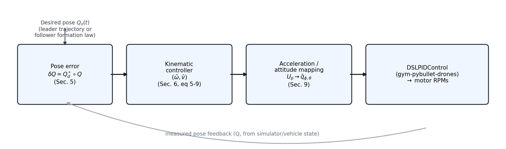

<p align="center">
  
</p>

# AB6: Introduction to Drones — Leader-Follower Formation of Two Quadrotors

**Data-driven control is now the default command-line workflow.** Simulator
state/action/next-state recordings train a separate response model for each
backend. A predictive optimizer uses that model and dual-quaternion pose error
to choose commands during every flight step. The original controller is retained
as `--controller analytic` for data collection and comparisons.
See [training, results, limitations, and launch commands](docs/data_driven.md).

**Desktop simulation UI:** Launch the interactive control panel with
`python scripts/run_ui.py`. The compact panel launches separate simulator
windows; it no longer attempts to embed native windows. PyBullet, MuJoCo and
Gazebo offer learned control with a trained response model. Kinematic mode
uses analytic control and a separate 3D reference plot. ArduPilot SITL is also
listed, with installation requirements described in [its guide](ardupilot/README.md).
Leader speed, follower gap, route radius, and flight altitude can be adjusted
while the simulation runs; applied values are displayed as they change.
See [desktop control details](docs/ui_controls.md). On Windows, Gazebo and ROS run inside WSL (Ubuntu 24.04 by
default); see [Gazebo setup](gazebo/README.md) for the required packages and
WSL settings.
Train first with `python scripts/train_data_driven.py --simulator pybullet`,
then run `python scripts/run_experiment.py --simulator pybullet --gui`.

**ArduPilot + Gazebo live demo:** see [setup and run instructions](ardupilot/README.md).
After one-time installation, `bash scripts/run_ardupilot.sh 60` launches two
ArduCopter SITLs, takes off, shows 60 seconds of leader–follower flight in
Gazebo with red/blue trails, then lands and stops. VS Code tasks also prompt
for duration. ArduPilot uses its own SITL-identified dynamics model inside a
dual-quaternion predictive controller (`--controller data_driven`, which
`learned` and the default `auto` select on ArduPilot); ArduPilot handles
low-level flight control. The same controller is available from the desktop UI.
See [ArduPilot data generation, training and validation](docs/data_driven.md#arducopter-sitl-data-driven-dual-quaternion-formation-control).

**Supporting course concepts:** See [the runnable guide](docs/course_concepts.md)
for B-spline and LERP/SLERP references, optional position Kalman filtering,
CVXPY path smoothing, hover stability/prediction, and Taylor/RK45 examples.
The original dual-quaternion controller and paper gain sets are retained.
Use `--simulator kinematic --controller analytic` for an ideal control-law demonstration without a
physics engine; the existing physics backends remain available.

**Follow the leader's actual route (new default):** the follower targets a point
0.8 m behind along the leader's recorded track, instead of a translated copy
of the trajectory. GUI runs draw red leader and blue follower trails.
Use `--follow_distance 0.8` to set the along-path gap, `--no-trails` to hide
lines, or `--follower_offset_mode world` for the original paper formation.
See [path-following details](docs/path_following.md).

Sections 3–9 retain the mathematical foundation and **original analytic baseline**.
Section 10 explains the current path-following reference; Section 20 derives the
**learned predictive controller**. Measured simulator results are collected at the end in Section 22. The project began as a simulation of
**dual quaternion-based control for a leader-follower formation of two quadrotors**, built to reproduce and explore the ideas from:

> H. N. Marciano, D. K. D. Villa, M. Sarcinelli-Filho, J. I. Giribet, *"Dual Quaternion-Based Control for a Leader-Follower Formation of Two Quadrotors,"* 2024 International Conference on Unmanned Aircraft Systems (ICUAS), Chania, Crete, Greece, June 4–7, 2024.

This document is written so that someone with **no prior background** in quaternions, dual numbers, or formation control can follow the math and the control design step by step, and then map each concept directly onto the code in this repository.

This README explains the mathematical concepts, their implementation, and the measured simulator results.

---

## Table of Contents

1. [Project Overview](#1-project-overview)
2. [Why Dual Quaternions?](#2-why-dual-quaternions)
3. [Mathematical Building Blocks](#3-mathematical-building-blocks)
   - 3.1 [Quaternions](#31-quaternions)
   - 3.2 [Quaternions as Rotations](#32-quaternions-as-rotations)
   - 3.3 [Dual Numbers](#33-dual-numbers)
   - 3.4 [Dual Quaternions](#34-dual-quaternions)
   - 3.5 [Dual Quaternions as Rigid-Body Pose](#35-dual-quaternions-as-rigid-body-pose)
4. [Vehicle Kinematics in Dual Quaternions](#4-vehicle-kinematics-in-dual-quaternions)
5. [Pose Error and the Control Objective](#5-pose-error-and-the-control-objective)
6. [The Kinematic Control Law](#6-the-kinematic-control-law)
7. [Why Tuning Is Hard: The Linearized Error Dynamics](#7-why-tuning-is-hard-the-linearized-error-dynamics)
8. [The Pole-Placement / Gain-Selection Method](#8-the-pole-placement--gain-selection-method)
9. [From Kinematics to Quadrotor Commands](#9-from-kinematics-to-quadrotor-commands)
10. [Leader-Follower Formation Law](#10-leader-follower-formation-law)
11. [Repository Structure](#11-repository-structure)
12. [Folder-by-Folder Walkthrough](#12-folder-by-folder-walkthrough)
    - 12.1 [dq_control/ — the math and control library](#121-dq_control--the-math-and-control-library)
    - 12.2 [simulators/ — the simulator bridge](#122-simulators--the-simulator-bridge)
    - 12.3 [scripts/ — command-line entry points](#123-scripts--command-line-entry-points)
    - 12.4 [utils/ — logging and metrics](#124-utils--logging-and-metrics)
    - 12.5 [configs/](#125-configs)
    - 12.6 [tests/](#126-tests)
13. [Installation & Setup](#13-installation--setup)
14. [How to Run an Experiment](#14-how-to-run-an-experiment)
15. [Visualizing Results and Metrics](#15-visualizing-results-and-metrics)
16. [Running the Tests](#16-running-the-tests)
17. [Design Notes: From Kinematic Twist to Motor Commands](#17-design-notes-from-kinematic-twist-to-motor-commands)
18. [Quick Reference](#18-quick-reference)
19. [Notation Glossary](#19-notation-glossary)
20. [Data-Driven Dual-Quaternion Control](#20-data-driven-dual-quaternion-control)
21. [Current Workflow and Course Concepts](#21-current-workflow-and-course-concepts)
22. [Results by Simulation](#22-results-by-simulation)

---

## 1. Project Overview

Coordinating multiple drones is a core problem in robotics: think of a "leader" drone flying a planned path while one or more "follower" drones automatically maintain a fixed relative position and orientation with respect to it. This is the **leader-follower formation control** paradigm.

The reference paper tackles this problem for **two small quadrotors** using **dual quaternions** — a single mathematical object that represents *both* the orientation *and* the position of a rigid body at once. The paper's main contributions are:

- A **kinematic control law**, expressed purely in dual quaternions, that drives a vehicle's pose (position + attitude) to a desired, possibly time-varying, pose.
- A **systematic method for choosing controller gains** (instead of trial and error), based on analyzing the eigenvalues of the *linearized* closed-loop error dynamics.
- **Experimental validation** on two real Parrot Bebop 2 quadrotors flying a leader-follower Lemniscate ("figure-eight") trajectory, under three different gain-tuning strategies.

The original implementation reproduced the analytic control pipeline in simulation. The current project extends it into **simulator-trained predictive control**: recorded state–command–next-state transitions identify a response model, and an optimizer uses that model with dual-quaternion pose error to choose commands during flight. Both vehicles use this controller in learned mode.

The leader still follows a chosen mathematical reference. The follower instead targets an earlier pose on the leader's **measured path from the current flight**, normally 0.8 m behind by arc length. This is different from replaying a prerecorded training route. Red and blue trails display actual leader and follower movement.

| Component | Original baseline | Current implementation |
|---|---|---|
| High-level commands | Analytic proportional/integral law with selected gains | Learned response prediction plus bounded optimization |
| Training | No identification stage | Four simulator flights fit the response model; a fifth checks prediction |
| Pose mathematics | Dual quaternions | Preserved, including relative pose error |
| Follower reference | Spatially offset leader pose | Chronological leader-path history with interpolation |
| Interaction | Command-line experiment | CLI plus a live control panel and separate viewers |
| Validation | Analytic examples and tests | Model-prediction checks, controller comparisons, tracking logs and tests |

This is **data-driven high-level control**, not an entirely learned flight stack. Physics, low-level stabilization, pose kinematics, objective weights and some command constraints are designed. Training happens offline; flight commands are recalculated online. The paper's real-drone experiments are background evidence, not experiments performed by this repository.

---

## 2. Why Dual Quaternions?

Classical approaches represent a rigid body's **attitude** (orientation) with rotation matrices or quaternions, and its **position** separately as a 3D vector. This works, but it means:

- Position and orientation are updated and controlled with *different* mathematical tools.
- Combining/composing successive rigid-body transformations (rotate, then translate, then rotate again, etc.) requires juggling matrices and vectors together, which is computationally heavier and easier to get subtly wrong.

**Dual quaternions solve this by unifying position and orientation into a single 8-dimensional algebraic object.** Just as a unit quaternion compactly encodes a 3D rotation, a *unit dual quaternion* compactly encodes a full **rigid-body pose** (rotation **and** translation) — and, crucially, poses can be *composed* with a single quaternion-like product, exactly the way rotations compose for ordinary quaternions. This gives:

- A unified, singularity-free representation of pose (no gimbal lock, unlike Euler angles).
- Computationally efficient composition and inversion of transformations.
- A natural way to define a single **pose error** between "where the drone is" and "where it should be," combining position and attitude error into one quantity.

This is why the paper — and this project — builds the entire leader-follower controller on top of dual quaternion algebra.

> **Worked comparison — why "one object" actually matters in practice**
>
> Suppose you need to compose three successive rigid-body transforms (e.g., "world → leader body → camera mount → gimbal"). With the classical representation you carry a rotation matrix $R \in  SO(3)$ **and** a translation vector $t \in  \mathbb R^{3}$ for each transform, and composing two transforms $(R_{1},t_{1})$ then $(R_{2},t_{2})$ requires the (easy to get wrong) rule:
>
> $$
> (R_2, t_2) \circ (R_1, t_1) = (R_2 R_1, R_2 t_1 + t_2)
> $$
>
> — a matrix-vector rule that is *different* from ordinary matrix multiplication. With unit dual quaternions, composing $Q_{2}$ after $Q_{1}$ is **exactly one dual-quaternion product**, $Q_{2} \circ  Q_{1}$, using the *same* multiplication rule you'd use to compose pure rotations. There is nothing special to remember, and inverting a transform is just the conjugate, $Q^{-1} = Q*$, instead of $(R,t)^{-1} = (R^{\mathsf T}, -R^{\mathsf T}t)$. This is exactly what `DualQuaternion.__mul__` and `.inverse()` (or equivalent) implement in `dq_control/dual_quaternion.py`.
>
> | | Rotation matrix + vector | Unit dual quaternion |
> |---|---|---|
> | Storage | 9 + 3 = 12 numbers (with 6 constraints) | 8 numbers (with 2 constraints: $\Vert \bar{q}\Vert =1$ and the dual-part orthogonality condition) |
> | Compose two poses | $(R_{2}R_{1}, R_{2}t_{1}+t_{2})$ — two different operations | $Q_{2} \circ  Q_{1}$ — one product |
> | Invert a pose | $(R^{\mathsf T}, -R^{\mathsf T}t)$ | $Q*$ |
> | Interpolate poses | Needs separate schemes for rotation (e.g. SLERP) and translation (linear) | Screw Linear Interpolation (ScLERP) handles both together |
> | Singularities | None for matrices; Euler angles have gimbal lock | None (like plain quaternions) |

---

## 3. Mathematical Building Blocks

To understand dual quaternions, we build up from ordinary quaternions and dual numbers.

### 3.1 Quaternions

Quaternions extend complex numbers to four dimensions. A quaternion is written as:

$$
\bar q = q + q_0, \qquad q \in \mathbb{R}^3,\ q_0 \in \mathbb{R}
$$

or, in the classical notation:

$$
\bar q = q_0 + i q_1 + j q_2 + k q_3
$$

where $i, j, k$ are imaginary units satisfying $i^{2} = j^{2} = k^{2} = ijk = -1$. Equivalently, a quaternion can be split into:

- a **vector part** $q \in  \mathbb R^{3}$ (analogous to the "imaginary" components), and
- a **scalar part** $q_{0} \in  \mathbb R$ (the "real" component).

Quaternion multiplication is **not commutative** ($p \circ  q \ne  q \circ  p$ in general) — order matters, just like it does for 3D rotations. Given $p = (p, p_{0})$ and $q = (q, q_{0})$, the quaternion product can be written compactly in matrix form as:


$$
p \circ q =
\begin{bmatrix}
S(p) + p_0 I & p \\
-p^{\mathsf{T}} & p_0
\end{bmatrix}
\begin{bmatrix}
q \\
q_0
\end{bmatrix}
$$

where $S(\cdot )$ is the **skew-symmetric matrix** built from a vector such that $S(v) w = v \times  w$ — i.e., matrix multiplication by $S(v)$ reproduces the cross product with $v$.

Other key operations:
- **Conjugate:** $q* = (-q, q_{0})$ (flip the sign of the vector part).
- **Norm:** $\Vert q\Vert ^{2} = q \circ  q* = q* \circ  q$ (a scalar).
- A vector $p \in  \mathbb R^{3}$ can always be embedded as a *pure* quaternion $\bar{p} = (p, 0)$ (zero scalar part).


### 3.2 Quaternions as Rotations

A **unit-norm quaternion** ($\Vert q\Vert  = 1$) represents a rotation in 3D space, analogous to how a unit complex number represents a rotation in 2D. If $\bar{q}$ is the unit quaternion rotating from body frame $b$ to inertial frame $i$, a vector expressed in the body frame transforms to the inertial frame via the **sandwich product**:

$$
\bar p^i = \bar q \circ \bar p^b \circ \bar q^*
$$

Note that $\bar{q}$ and $-\bar{q}$ represent the *same* rotation — this "double cover" is a well-known and harmless property of quaternions.

If the body rotates with angular velocity $\omega$ (expressed in the body frame), the quaternion evolves according to:

$$
\dot{\bar q} = \tfrac{1}{2} \bar q \circ \bar\omega
$$

This single differential equation replaces the more cumbersome update equations needed for rotation matrices or Euler angles, and it has no singularities.


### 3.3 Dual Numbers

Before combining quaternions with position, we need one more ingredient: **dual numbers**. A dual number has the form:

$$
\hat\alpha = a + \varepsilon b, \qquad a, b \in \mathbb{R}
$$

where $\varepsilon$ is a symbol (the *dual unit*) with the defining property:

$$
\varepsilon \neq 0, \qquad \varepsilon^2 = 0
$$

This is conceptually similar to how $i^{2} = -1$ defines complex numbers, except here squaring the special symbol gives **zero**, not $-1$. (Important: $\varepsilon$ is *not* "a small number close to zero" — it's an abstract algebraic symbol.)

Dual numbers add component-wise, and multiply using the rule $\varepsilon ^{2} = 0$:

$$
(a + b\varepsilon)(c + d\varepsilon) = ac + (ad + bc)\varepsilon
$$

Intuitively, $a$ is the "principal" or nominal value, and $b$ is a first-order "perturbation" or "derivative-like" term riding along with it. This structure is exactly what's needed to piggy-back *position* information onto *orientation* information.


### 3.4 Dual Quaternions

A **dual quaternion** is obtained by applying the same trick that built complex-like dual numbers from real numbers — but starting from quaternions instead of reals:

$$
Q = \bar r + \varepsilon \bar s, \qquad \bar r, \bar s \in \mathbb{H}
$$

where $\mathbb H$ is the set of quaternions. $Q$ is an 8-dimensional object (4 real dimensions from $\bar{r}$, 4 more from $\bar{s}$). We call:

- $\mathcal P(Q) = \bar{r}$ the **principal part**,
- $\mathcal D(Q) = \bar{s}$ the **dual part**.

Sum, product, and conjugation extend naturally from quaternions, always remembering $\varepsilon ^{2} = 0$. The dual quaternion conjugate is:

$$
Q^* = \mathcal{P}(Q)^* + \varepsilon \mathcal{D}(Q)^*
$$


### 3.5 Dual Quaternions as Rigid-Body Pose

Just as a **unit quaternion** represents pure rotation, a **unit dual quaternion** ($Q \circ  Q* = Q* \circ  Q = 1$) represents a full rigid-body **pose** — rotation *and* translation together. Concretely:

- $Q$ has unit norm **if and only if** its principal part $\mathcal P(Q) = \bar{q}$ is itself a unit quaternion (the attitude), and its dual part is:

$$
\mathcal{D}(Q) = \tfrac{1}{2} \bar p \circ \mathcal{P}(Q)
$$

  where $\bar{p} = (p, 0)$ is the position vector $p \in  \mathbb R^{3}$, embedded as a pure quaternion.

- Given any unit dual quaternion $Q$, you can always **recover** the attitude and position:

$$
\bar q = \mathcal{P}(Q), \qquad \bar p = 2\mathcal{D}(Q) \circ \mathcal{P}(Q)^*
$$

So a single object $Q = \bar{q} + \varepsilon \cdot \frac12 (\bar{p} \circ  \bar{q})$ carries everything needed to describe "where the drone is and how it's oriented" — and dual quaternion multiplication automatically composes both the rotations *and* the translations correctly, in the right order.


---

## 4. Vehicle Kinematics in Dual Quaternions

The **twist** (linear + angular velocity) of a vehicle is also packaged into a dual quaternion:

$$
\Omega(\bar\omega, \bar v), \qquad \mathcal{P}(\Omega) = \bar\omega,\quad \mathcal{D}(\Omega) = \mathcal{P}(Q)^* \circ \bar v \circ \mathcal{P}(Q)
$$

and the pose evolves in time according to a beautifully compact single equation:

$$
\dot Q = \tfrac{1}{2} Q \circ \Omega(\bar\omega, \bar v)
$$

This is the dual-quaternion analogue of $\dot{q} = \frac12  q \circ  \bar{\omega}$ for pure rotation — it simultaneously propagates both position and attitude, using commanded body-frame angular velocity $\omega$ and inertial-frame linear velocity $v$. This is the equation the simulation integrates forward in time to move each drone.


---

## 5. Pose Error and the Control Objective

Let $Q$ be the vehicle's **current** pose and $Q_d$ the **desired** pose. The **pose error** is defined as a single dual quaternion:

$$
\delta Q = Q_d^* \circ Q = \delta \bar q + \varepsilon \tfrac{1}{2}\left(\overline{\delta p}^{b} \circ \delta \bar q\right)
$$

where:
- $\delta \bar{q} = \bar{q}_d^* \circ \bar{q}$ is the **attitude error** (a quaternion — how far the current orientation is from the desired one),
- $\delta p = p - p_d$ is the raw **position error**, and
- $\delta \bar{p}^{b} = \bar{q}_d^* \circ \delta \bar{p} \circ \bar{q}_d$ is that position error expressed **in the desired body frame** — the natural frame to regulate it in.

The **control goal** is simply: drive $\delta Q \to  1$ (the identity dual quaternion), i.e., make the attitude-error vector and position error approach zero (the full error quaternion approaches the identity), meaning the vehicle's actual pose converges to the desired pose. Both position and attitude errors are captured by this one object.


---

## 6. The Kinematic Control Law

> **Analytic baseline:** this section preserves the original derivation. Learned mode uses the predictive formulation in Section 20; these gain-based stability arguments do not prove stability of the learned controller.

The controller computes the **commanded twist** $(\bar{\omega}, \bar{v})$ sent to the vehicle as a function of the pose error. It uses six gain matrices:

$$
K_{\omega,p}, K_{v,p}, K_{\omega,i}, K_{v,i}, K_{\eta}, K_{\xi} \in \mathbb{R}^{3\times3}
$$

For the stability result, these gain matrices are required to be **negative definite**.

### Angular velocity command

$$
\bar{\omega} = \delta\bar{q}^{*} \circ \bar{\omega}_d \circ \delta\bar{q} + \left( \mathrm{sgn}(\delta q_0) \left( K_{\omega,p}\delta q + \eta_0 K_{\omega,i}\eta \right),  0 \right)
$$

Here:

- $\bar{\omega}$ is the commanded angular velocity represented as a pure quaternion.
- $\bar{\omega}_d$ is the desired angular velocity.
- $\delta\bar{q}$ is the attitude-error quaternion.
- $\delta q$ is the vector part of $\delta\bar{q}$.
- $\delta q_0$ is the scalar part of $\delta\bar{q}$.
- $\eta$ is the vector part of the attitude integral state.
- $\eta_0$ is the scalar part of the attitude integral quaternion $\bar{\eta}$.

### Linear velocity command

$$
\bar{v} = \bar{v}_d + \mathcal{R}(\bar{q}_d) \left( K_{v,p}\delta p^{b} + K_{v,i}\xi \right)
$$

Here, $\delta p^{b}$ is the position error expressed in the desired body frame.

### Attitude integral state

$$
\dot{\bar{\eta}} = \frac{1}{2} \bar{\eta} \circ \left( -|\delta q_0| K_{\omega,i}\delta q + \mathrm{sgn}(\eta_0) K_{\eta}\eta,  0 \right)
$$

The $K_{\eta}\eta$ term acts as a **forgetting/leakage term**, preventing the integral state from growing without bound.

### Position integral state

$$
\dot{\xi} = -K_{v,i}\delta p^{b} + K_{\xi}\xi
$$

The first term accumulates the position error, while $K_{\xi}\xi$ provides the corresponding forgetting mechanism.

### Interpretation

- The **feedforward** terms $\bar{\omega}_d$ and $\bar{v}_d$ provide the velocity required by the desired trajectory.
- The **proportional** terms $K_{\omega,p}\delta q$ and $K_{v,p}\delta p^{b}$ respond to the instantaneous pose error.
- The **integral** terms involving $\eta$ and $\xi$ accumulate persistent tracking errors.
- The $K_{\eta}$ and $K_{\xi}$ terms prevent excessive accumulation of the integral states.

The closed-loop error states converge toward the desired equilibrium:

$$
\delta\bar{q}\rightarrow\bar{1}, \qquad \delta p\rightarrow0, \qquad \eta\rightarrow0, \qquad \xi\rightarrow0
$$

Here, $\bar{1}$ denotes the **identity quaternion**, representing zero attitude error.


---

## 7. Why Tuning Is Hard: The Linearized Error Dynamics

> **Analytic baseline:** this section preserves the original derivation. Learned mode uses the predictive formulation in Section 20; these gain-based stability arguments do not prove stability of the learned controller.

Adding the integral states $\eta$ and $\xi$ improves steady-state tracking, but it also introduces additional gain matrices.

For the attitude subsystem, the relevant gains are

$$
K_{\omega,p}, \qquad K_{\omega,i}, \qquad K_{\eta}
$$

The closed-loop attitude dynamics are linearized around the equilibrium

$$
(\delta q,\eta)=(0,0)
$$

The resulting linearized system is

$$
\begin{bmatrix} \dot{\delta q}\\ \dot{\eta} \end{bmatrix} = M_{\omega} \begin{bmatrix} \delta q\\ \eta \end{bmatrix}
$$

where

$$
M_{\omega} = \frac{1}{2} \begin{bmatrix} K_{\omega,p} & K_{\omega,i}\\ -K_{\omega,i} & K_{\eta} \end{bmatrix}
$$

Since each gain matrix is 3×3, $M_{\omega}$ is a 6×6 matrix.

An analogous matrix $M_v$ describes the linearized position-error dynamics.

For a linear system

$$
\dot{x}=Mx
$$

the eigenvalues of $M$ determine the local behavior of the system.

If

$$
\lambda<0
$$

the corresponding mode decays exponentially.

If

$$
\lambda=\alpha\pm j\beta, \qquad \alpha<0
$$

the corresponding mode decays while oscillating.

Therefore:

- **Real negative eigenvalues** → non-oscillatory exponential convergence.
- **Complex eigenvalues with negative real parts** → damped oscillatory behavior.
- **Eigenvalues with positive real parts** → instability.

Consequently, selecting the controller gains can be viewed as a structured **pole-placement problem**.

The difficulty is that $M_{\omega}$ is a block matrix. Its eigenvalues cannot, in general, be determined simply by considering the eigenvalues of the individual matrices

$$
K_{\omega,p}, \qquad K_{\omega,i}, \qquad K_{\eta}
$$

Therefore, making each gain matrix individually negative definite does not by itself determine the exact eigenvalues of the complete matrix $M_{\omega}$.


---

## 8. The Pole-Placement / Gain-Selection Method

> **Analytic baseline:** this section preserves the original derivation. Learned mode uses the predictive formulation in Section 20; these gain-based stability arguments do not prove stability of the learned controller.

The linearized matrix $M_{\omega}$ has a special spectral structure.

Define

$$
H = \begin{bmatrix} I_3 & 0\\ 0 & -I_3 \end{bmatrix}
$$

and the corresponding indefinite inner product

$$
[x,y]_H = x^{\mathsf T}Hy
$$

The matrix $M_{\omega}$ satisfies

$$
HM_{\omega} = M_{\omega}^{\mathsf T}H
$$

Therefore, $M_{\omega}$ is **$H$-self-adjoint**.

Define

$$
a_- = \lambda_{\min}\left(\frac{1}{2}K_{\omega,p}\right), \qquad a_+ = \lambda_{\max}\left(\frac{1}{2}K_{\omega,p}\right)
$$

and

$$
d_- = \lambda_{\min}\left(\frac{1}{2}K_{\eta}\right), \qquad d_+ = \lambda_{\max}\left(\frac{1}{2}K_{\eta}\right)
$$

The coupling between the proportional and integral dynamics is determined by $K_{\omega,i}$.

The spectral bounds therefore depend on quantities such as

$$
\left\| K_{\omega,p}^{-1}K_{\omega,i} \right\|
$$

and

$$
\left\| K_{\eta}^{-1}K_{\omega,i} \right\|
$$

If the coupling introduced by $K_{\omega,i}$ is sufficiently small compared with the separation between the spectra associated with $K_{\omega,p}$ and $K_{\eta}$, the eigenvalues of $M_{\omega}$ can be guaranteed to remain real and negative:

$$
\lambda_i(M_{\omega})\in\mathbb{R}, \qquad \lambda_i(M_{\omega})<0
$$

This produces a locally exponentially convergent and non-oscillatory response.

If the coupling becomes too strong, complex eigenvalues can appear:

$$
\lambda_{1,2} = \alpha\pm j\beta, \qquad \alpha<0
$$

which corresponds to damped oscillatory behavior.

### Practical Gain-Selection Procedure

1. Select the proportional gains:

   $$K_{\omega,p}, \qquad K_{v,p}$$

2. Select the integral-related gains:

   $$K_{\omega,i}, \qquad K_{\eta}, \qquad K_{v,i}, \qquad K_{\xi}$$

3. Construct the linearized attitude matrix:

   
```math
M_{\omega} = \frac{1}{2} \begin{bmatrix} K_{\omega,p} & K_{\omega,i}\\ -K_{\omega,i} & K_{\eta} \end{bmatrix}
```

4. Construct the corresponding position matrix $M_v$.

5. Compute their eigenvalues:

   $$\lambda(M_{\omega}), \qquad \lambda(M_v)$$

6. Select gains that produce eigenvalues with negative real parts. When a smooth non-oscillatory response is desired, select gains satisfying the conditions that keep the eigenvalues real and negative.


---

## 9. From Kinematics to Quadrotor Commands

> **Analytic baseline:** this section preserves the original derivation. Learned mode uses the predictive formulation in Section 20; these gain-based stability arguments do not prove stability of the learned controller.

The kinematic controller produces the desired twist

$$
(\bar{\omega},\bar{v})
$$

A real quadrotor cannot directly generate an arbitrary three-dimensional velocity. Its motion is produced through thrust and attitude control.

The command variables considered in this project are

$$
u_{\phi}, \qquad u_{\theta}, \qquad u_{\dot z}, \qquad u_{\dot\psi}
$$

corresponding to roll, pitch, vertical velocity, and yaw-rate commands.

The horizontal motion requires an additional mapping because a quadrotor generates horizontal acceleration by **tilting its thrust vector**.

### Desired Acceleration

$$
U_p = \ddot{p}_{jd} + K_a\left(\dot{p}_j-v\right)
$$

Here:

- $p_{jd}$ is the desired position of vehicle $j$.
- $\dot{p}_{jd}$ is the desired velocity.
- $\ddot{p}_{jd}$ is the desired acceleration.
- $\dot{p}_j$ is the actual velocity.
- $v$ is the velocity generated by the kinematic controller.
- $K_a$ is the acceleration-level feedback gain.

### Thrust-Vector Alignment

Let $n_j$ denote the thrust axis of vehicle $j$.

The roll-pitch quaternion is constructed as

$$
\bar{q}'_{j\phi,\theta} = \left( n_j\times U_p, \left\langle n_j,U_p\right\rangle + \|U_p\| \right)
$$

It is then normalized:

$$
\bar{q}_{j\phi,\theta} = \frac{\bar{q}'_{j\phi,\theta}}{\left\|\bar{q}'_{j\phi,\theta}\right\|}
$$

This quaternion represents the rotation required to align the vehicle's thrust direction with the desired acceleration direction.

### Yaw Composition

The roll-pitch orientation does not uniquely determine yaw. Therefore, yaw is specified independently using the desired yaw quaternion $\bar{q}_{j\psi}$.

The complete desired attitude is

$$
\bar{q}_{jd} = \bar{q}_{j\phi,\theta} \circ \bar{q}_{j\psi}
$$

The complete control structure is therefore:

```
Pose error → Kinematic controller → (ω̄, v̄) → Acceleration/attitude mapping → Quadrotor commands
```

Visually, as a block diagram matching the code layering in `simulators/leader_follower.py` (see also §17):

<p align="center"></p>


---

## 10. Leader-Follower Formation Law

### 10.1 Current default: follow the leader's measured route

Let the measured leader positions be $p_L^0,p_L^1,\ldots,p_L^k$. Accumulated distance along the recorded trail is

$$
s_k=s_{k-1}+\left\|p_L^k-p_L^{k-1}\right\|_2.
$$

For following distance $d$, the desired trail coordinate is

$$
s_F^{\mathrm{target}}=\max(0,s_k-d).
$$

Choose the chronological neighboring samples whose distances bracket that target. Their interpolation fraction and the follower's desired position are

$$
\alpha=\frac{s_F^{\mathrm{target}}-s_a}{s_b-s_a},\qquad
p_{F,d}=(1-\alpha)p_L^a+\alpha p_L^b.
$$

Orientation is interpolated on the quaternion sphere:

$$
q_{F,d}=\mathrm{SLERP}(q_L^a,q_L^b,\alpha).
$$

The resulting position and attitude form the follower's desired dual quaternion. This reference is passed to the same selected controller as the leader's reference. At a figure-eight crossing, chronological history determines which segment to follow; the code does not jump to the nearest unrelated crossing segment.


`dq_control/path_following.py` implements this behavior. Initial history contains a seed segment between the two starting positions. Live-control runs retain extra history so increasing the gap can recover older points. Until sufficient history exists, the target is limited to the available segment. The gap is a reference arc length, not guaranteed physical separation or collision avoidance.

### 10.2 Original offset formulation

The following leader equations remain applicable. The fixed-offset follower derivation are retained for the explicit `world` formation mode; they are no longer the default follower reference.

The formation controller defines the desired pose that each vehicle should track.

Let

$$
j\in\{L,F\}
$$

where $L$ denotes the leader and $F$ denotes the follower.

### Leader

The leader follows a predefined position trajectory

$$
p_{Ld}(t)
$$

and a desired attitude

$$
\bar{q}_{Ld}(t)
$$

The leader's desired pose is represented by the dual quaternion

$$
Q_{Ld} = \bar{q}_{Ld}(t) + \varepsilon\frac{1}{2}\bar{p}_{Ld}(t) \circ \bar{q}_{Ld}(t)
$$

where $\varepsilon$ is the dual unit satisfying

$$
\varepsilon^2=0
$$

Thus, $Q_{Ld}$ simultaneously represents the desired position and orientation of the leader.

### Follower

The follower's desired position is generated from the leader's measured position and a formation offset:

$$
p_{Fd}(t) = p_L(t)+f(t)
$$

Here:

- $p_L(t)$ is the measured leader position.
- $f(t)$ is the desired formation offset.
- $p_{Fd}(t)$ is the resulting desired follower position.

The follower's desired attitude can be specified independently or chosen to follow the leader:

$$
\bar{q}_{Fd}(t) = \bar{q}_L(t)
$$


### Effect of Measurement Noise

Because the follower's desired position depends on the leader's measured position, measurement noise is directly transferred to the follower reference.

If

$$
p_L^m(t) = p_L(t)+n(t)
$$

then

$$
p_{Fd}^m(t) = p_L^m(t)+f(t) = p_L(t)+f(t)+n(t)
$$

Therefore, the follower's reference already contains the leader's measurement noise.

If velocity or acceleration is subsequently obtained using numerical differentiation, high-frequency measurement noise can be amplified further. This explains why the follower's trajectory can appear noisier than the leader's trajectory.


### Pose Error for Each Vehicle

Each vehicle runs its own copy of the kinematic controller.

For

$$
j\in\{L,F\}
$$

the dual-quaternion pose error is

$$
\delta Q_j = Q_{jd}^{*} \circ Q_j
$$

Therefore,

$$
\delta Q_L = Q_{Ld}^{*} \circ Q_L
$$

for the leader, and

$$
\delta Q_F = Q_{Fd}^{*} \circ Q_F
$$

for the follower.

The overall leader-follower structure is therefore:

```
Leader trajectory → Leader desired pose → Leader controller → Leader motion
```

```
Leader measured pose + Formation offset → Follower desired pose → Follower controller → Follower motion
```

---

## 11. Repository Structure

```text
dq_control/
  quaternion.py, dual_quaternion.py   # pose algebra and integration
  controller.py, gains.py            # analytic baseline
  learned_control.py                 # identification and predictive controller
  path_following.py                  # measured leader-history reference
  trajectories.py, course_trajectories.py
  estimation.py, optimization.py     # optional filtering and path smoothing
simulators/
  base.py, registry.py                # common state/command interface
  leader_follower.py                  # shared experiment loop and live controls
  gym_pybullet.py, mujoco.py, gazebo.py, kinematic.py
  gazebo_wsl_worker.py                # Windows-to-WSL protocol
scripts/
  run_ui.py, run_experiment.py        # desktop and CLI entry points
  train_data_driven.py                # collection, fitting and evaluation
  plot_results.py, analyze_course_concepts.py
models/                              # saved response matrices and metadata
data/                                # identification and evaluation recordings
configs/                             # reference trajectory definitions
results/                             # timestamped experiment logs
assets/                              # retained mathematical illustrations
utils/                               # logging and metrics
tests/                               # algebra, control and integration checks
```

## 12. Folder-by-Folder Walkthrough

### 12.1 `dq_control/` — the math and control library

- `quaternion.py` and `dual_quaternion.py` implement the algebra, pose conversion and integration explained above.
- `controller.py` and `gains.py` retain the analytic baseline and the paper-inspired gain sets.
- `learned_control.py` defines state features, ridge fitting, saved-model validation, dual-quaternion error and bounded predictive command selection.
- `path_following.py` records measured leader poses and constructs the follower's delayed-by-distance target.
- `course_trajectories.py` supplies B-spline and interpolated-pose references. `estimation.py` supplies optional position Kalman filtering; `optimization.py` smooths B-spline control points with CVXPY.

### 12.2 `simulators/` — the simulator bridge

`LeaderFollowerSimulation` reads both drone states, builds their desired poses, calls their controllers, integrates each twist into a one-step target, applies commands, and logs actual motion. `DroneState` contains position, attitude, world velocity and body angular velocity. `VehicleCommand` supplies position/orientation targets plus linear and angular velocity commands.

| Backend | How commands produce movement | Viewer |
|---|---|---|
| PyBullet | gym-pybullet-drones low-level controller and motor dynamics | Native PyBullet window |
| MuJoCo | Bounded world-force translation, roll/pitch stabilization and bounded yaw tracking | Native MuJoCo window |
| Gazebo | ROS 2 actuator messages, motor model and quadrotor physics | Gazebo / WSLg window |
| Kinematic | Direct ideal twist integration, without motors or forces | Separate 3D reference plot in UI mode |

MuJoCo is not equivalent to the rotor-actuated backends. Cross-simulator numbers must not be interpreted as rankings of controller quality on identical physical systems.

### 12.3 `scripts/` — command-line entry points

`train_data_driven.py` collects four training flights and a separate validation flight, fits one backend-specific model, and compares analytic/learned control on additional trajectories. `run_experiment.py` loads a model in learned mode and saves a completed run. `run_ui.py` supports long-running interactive sessions; its callback path does not save the full CLI experiment log. Use the CLI when collecting results for a report.

### 12.4 `utils/` — logging and metrics

`logger.py` saves and loads NumPy archives. `metrics.py` supports the plotting script's MAE/MSE tables. The training report separately records Euclidean position RMSE, rotation-angle RMSE, altitude extrema and optimizer saturation counts. These measures have different meanings and must not be substituted for each other.

### 12.5 `configs/`

The course JSON files define B-spline control points/knots and interpolated-pose endpoints. `experiment_config.yaml` documents baseline parameters; Python modules and CLI parsing remain the authoritative execution settings.

### 12.6 `tests/`

Tests cover quaternion algebra, pose integration, analytic convergence, learned-model fitting and compatibility checks, absence of analytic fallback in learned mode, chronological path following, history retention, live parameter propagation and Windows-to-WSL trail forwarding.

---

## 13. Installation & Setup

### 13.1 Python environments

Use the existing Windows `.venv` for PyBullet, MuJoCo and the desktop panel. For a fresh Windows checkout, from the project root:

```powershell
py -m venv .venv
.\.venv\Scripts\python.exe -m pip install -r requirements.txt
.\.venv\Scripts\python.exe -m pip install mujoco
```

Optional course-path smoothing dependencies:

```powershell
.\.venv\Scripts\python.exe -m pip install -r requirements-course.txt
```

The requirements file selects NumPy versions according to Python version; do not replace those environment markers with an old hard-coded version list. Keep Windows and Linux environments separate. Do not recreate a Linux environment over the Windows `.venv`.

### 13.2 PyBullet dependency

The PyBullet backend needs the external `gym-pybullet-drones` package. If its repository is already beside this project:

```powershell
.\.venv\Scripts\python.exe -m pip install -e ../gym-pybullet-drones
```

If it is absent, clone that dependency into the sibling location first:

```powershell
git clone https://github.com/utiasDSL/gym-pybullet-drones.git ../gym-pybullet-drones
```

PyBullet wheel availability depends on the Python/platform combination. A source build can require a C++ compiler; installing only the high-level drone package is not sufficient if PyBullet itself fails to install.

### 13.3 Gazebo through Ubuntu / WSL

The current setup uses Ubuntu 24.04 with ROS 2 Jazzy and Gazebo Harmonic. Use the existing [Gazebo setup guide](gazebo/README.md) for system installation. In an Ubuntu terminal at this project root:

```bash
source /opt/ros/jazzy/setup.bash
source .venv-gazebo/bin/activate
```

CLI Gazebo flights run there. The Windows UI instead forwards commands to `gazebo_wsl_worker.py` in WSL, whose current launcher uses `python3` after sourcing ROS. Ensure the worker's Python has its dependencies; installing only into a different virtual environment does not make them visible to it. The worker also receives trail requests so markers are sent in the active Gazebo transport partition.

---

## 14. How to Run an Experiment

### 14.1 Train, then run learned control

In Windows PowerShell, from this project folder:

```powershell
.\.venv\Scripts\python.exe -B scripts/train_data_driven.py --simulator pybullet
.\.venv\Scripts\python.exe -B scripts/run_experiment.py --simulator pybullet --controller learned --trajectory lemniscate --follow_distance 0.8 --duration 60 --gui
```

Replace `pybullet` with `mujoco` in both commands for MuJoCo. Training is headless. Existing compatible model files can be reused; retrain after changing backend dynamics or command semantics. A missing or incompatible model fails explicitly rather than silently selecting analytic control.

In the prepared Ubuntu environment:

```bash
python -B scripts/train_data_driven.py --simulator gazebo
env -u QT_QUICK_BACKEND QT_QPA_PLATFORM=xcb LIBGL_ALWAYS_SOFTWARE=1 \
  python -B scripts/run_experiment.py --simulator gazebo --controller learned \
  --trajectory lemniscate --follow_distance 0.8 --duration 60 --gui \
  --gazebo_render_engine ogre
```

### 14.2 Desktop panel

```powershell
.\.venv\Scripts\python.exe -B scripts/run_ui.py
```

Select the backend, controller and leader route, then start. The panel stays separate from the native viewer. Speed, radius, altitude and gap sliders update the running simulation; gradual transitions avoid discontinuous targets, and the **applied** values are displayed separately. Simulator/controller/route selections are locked until the run stops. Kinematic mode selects analytic control and opens an ideal-motion plot, so it needs no trained model.

MuJoCo starts with its side menus hidden and a cleaner camera view. Its updated controller follows commanded yaw, and the response model was retrained after this dynamics change. Red denotes the leader and blue the follower. Closing the control panel requests simulator cleanup; the UI is not simply a window embedding host.

### 14.3 Main options

| Flag | Default | Purpose |
|---|---|---|
| `--simulator` | `pybullet` | Backend selection |
| `--controller` | `learned` | Learned predictive controller or `analytic` baseline |
| `--model` | Backend response file in `models/` | Explicit compatible learned model |
| `--experiment` | `real_eig` | Baseline gain selection; not a learned-model tuning option |
| `--trajectory` | `lemniscate` | Also `potato_chip`, `bspline`, `interpolated` |
| `--duration` | 30 seconds | CLI flight duration |
| `--ctrl_freq` | 48 Hz | Must match model control timestep |
| `--physics_freq` | 240 Hz | Keep consistent with training/backend configuration |
| `--follower_offset_mode` | `path` | Recorded path; explicit `world`/`body` modes retain offset behavior |
| `--follow_distance` | 0.8 m | Arc-length target gap in path mode |
| `--gui` | Off | Display backend viewer |
| `--no-trails` | Off | Disable actual-motion trails |
| `--position_noise_std` | 0 | Inject measurement noise per position axis |
| `--kalman` | Off | Optional position/velocity estimation |
| `--optimize_path` | Off | CVXPY B-spline control-point smoothing |
| `--output` | `results/` | Completed CLI run location |

Run `python scripts/run_experiment.py --help` in the selected environment for all shape and configuration options. `SimConfig` retains an analytic API default for compatibility; the CLI defaults to learned mode. Explicitly select the desired controller in Python scripts.

### 14.4 Baseline and alternative references

```powershell
.\.venv\Scripts\python.exe -B scripts/run_experiment.py --simulator pybullet --controller analytic --experiment real_eig --follower_offset_mode world --duration 30 --gui
.\.venv\Scripts\python.exe -B scripts/run_experiment.py --simulator pybullet --controller learned --trajectory bspline --duration 30 --gui
.\.venv\Scripts\python.exe -B scripts/run_experiment.py --simulator mujoco --controller learned --trajectory potato_chip --duration 60 --gui
.\.venv\Scripts\python.exe -B scripts/run_experiment.py --simulator kinematic --controller analytic --duration 30
```

The first command explicitly selects the baseline formation; alternative gain sets are `proportional` and `complex_eig`. The last command is headless ideal integration, not a quadrotor physics flight.

---

## 15. Visualizing Results and Metrics

Completed CLI logs include actual/desired poses and the run settings; learned runs also record the model hash. Filenames include simulator, controller, experiment, trajectory and timestamp. Plot an actual saved file with:

```powershell
$run = Get-ChildItem results/pybullet_learned_*.npz |
  Sort-Object LastWriteTime -Descending | Select-Object -First 1
.\.venv\Scripts\python.exe -B scripts/plot_results.py --run $run.FullName
```

For position tracking, the training report uses

$$
\mathrm{RMSE}_p=\sqrt{\frac{1}{N}\sum_{k=1}^{N}\|p_k-p_{d,k}\|_2^2}.
$$

For a relative orientation quaternion with vector part $q_v$ and scalar part $q_0$, the shortest rotation-angle error and its RMSE are

$$
\theta_k=2\mathrm{atan2}(\|q_v\|_2,|q_0|),\qquad
\mathrm{RMSE}_{\theta}=\sqrt{\frac{1}{N}\sum_{k=1}^{N}\theta_k^2}.
$$

Position error is measured against each vehicle's own desired pose. It does not by itself prove exact geometric retracing, a guaranteed inter-drone distance, or collision avoidance. All measured simulator results are collected in Section 22 at the end.

## 16. Running the Tests

```powershell
.\.venv\Scripts\python.exe -B -m pytest -q
```

The latest full check during this update reported **38 passed, 1 skipped**, with one CVXPY backend-fallback warning. Passing numerical/unit tests does not establish GUI rendering on every machine or stability at every live-slider setting.

## 17. Design Notes: From Kinematic Twist to Motor Commands

The high-level controller returns body angular rate and world linear velocity. Known dual-quaternion kinematics integrate these into a short-horizon target pose. Each backend then implements that target differently: motor control in PyBullet/Gazebo, simplified force and yaw-torque control in MuJoCo, or direct integration in the ideal reference.

The learned response therefore identifies the **closed-loop backend**, including its existing low-level behavior. It does not identify a universal bare-airframe model. A model trained in one simulator must not be reused by renaming its file for another simulator. Backend and control timestep checks reject incompatible saved models. Other physics and low-level changes still require deliberate retraining.

## 18. Quick Reference

```powershell
# Open the live control panel
.\.venv\Scripts\python.exe -B scripts/run_ui.py

# Generate training data and fit the response model
.\.venv\Scripts\python.exe -B scripts/train_data_driven.py --simulator pybullet

# Refit existing matching recordings and rerun evaluation
.\.venv\Scripts\python.exe -B scripts/train_data_driven.py --simulator pybullet --reuse-data

# Run the trained controller and save a flight
.\.venv\Scripts\python.exe -B scripts/run_experiment.py --simulator pybullet --controller learned --duration 60 --gui
```

See [the command PDF](output/pdf/simulator_running_commands.pdf) for the earlier command reference and [current UI notes](docs/ui_controls.md) for panel behavior. The README and source reflect the latest yaw and UI updates.

---

## 19. Notation Glossary

| Symbol | Meaning | First used in |
|---|---|---|
| $\bar q, \bar p, \bar\omega, \dots$ | A quaternion (vector part + scalar part, an over-bar marks "this is a quaternion") | §3.1 |
| $q, q_0$ | Vector part and scalar part of quaternion $\bar q$ | §3.1 |
| $\circ$ | Quaternion (or dual quaternion) product — the non-commutative Hamilton product | §3.1 |
| $S(\cdot)$ | Skew-symmetric matrix operator, $S(v)w = v\times w$ | §3.1 |
| $q^*$ | Conjugate (flips the sign of the vector part) | §3.1 |
| $\varepsilon$ | The dual unit, an abstract symbol with $\varepsilon^2=0$ (not "a small number") | §3.3 |
| $Q$ | A dual quaternion, $Q=\bar r + \varepsilon\bar s$ | §3.4 |
| $\mathcal P(Q), \mathcal D(Q)$ | Principal part / dual part of a dual quaternion | §3.4 |
| $\Omega(\bar\omega,\bar v)$ | The twist dual quaternion packaging angular velocity $\bar\omega$ and linear velocity $\bar v$ | §4 |
| $\delta Q, \delta\bar q, \delta p, \delta p^{b}$ | Pose error, attitude error, raw position error, position error expressed in the desired body frame | §5 |
| $K_{\omega,p}, K_{v,p}$ | Proportional gain matrices (attitude, position) | §6 |
| $K_{\omega,i}, K_{v,i}$ | Integral-coupling gain matrices (attitude, position) | §6 |
| $K_\eta, K_\xi$ | Integral-state "forgetting"/leakage gain matrices | §6 |
| $\eta, \xi$ | Attitude and position integral (error-accumulator) states | §6 |
| $M_\omega, M_v$ | Linearized closed-loop error-dynamics matrices (attitude, position) | §7 |
| $\lambda(\cdot)$ | Eigenvalue(s) of a matrix | §7 |
| $H$-self-adjoint | $M$ satisfies $HM=M^{\mathsf T}H$ for an indefinite $H$; governs the structure of $M_\omega$'s spectrum | §8 |
| $U_p$ | Desired (feedback-corrected) acceleration fed into the thrust-alignment step | §9 |
| $n_j$ | Body thrust axis of vehicle $j$ | §9 |
| $L, F$ | Subscripts denoting the Leader and Follower vehicle | §10 |
| $f(t)$ | Time-varying formation offset (Leader → Follower) | §10 |
| $p^m, n(t)$ | Measured (noisy) position, and the measurement-noise vector itself | §10 |


---

## 20. Data-Driven Dual-Quaternion Control

> **Backend scope:** Sections 20.1–20.4 describe `LearnedDQController` in `dq_control/learned_control.py`, used by PyBullet, MuJoCo and the standalone Gazebo backend. ArduPilot uses `DataDrivenDQController` in `dq_control/data_driven.py`, described in Section 20.5. Both use simulator-trained prediction and dual-quaternion poses, but their state features, command interfaces, pose-error conventions and optimizers differ. The training counts and 24-step horizon below belong to the first implementation, not automatically to ArduPilot.

### 20.1 What is learned, and why it changes the implementation

The original controller calculates commands from selected gains and pose error. The current learned controller first measures how a simulator responds to commands, fits that response, and uses the fitted model inside every command calculation. Removing the model prevents learned mode from starting: it is not an optional graph or a parallel classroom demonstration.

The leader's route remains a chosen reference. The training recordings describe vehicle response; they are not a prerecorded route that the follower replays. The follower uses the current flight's measured leader history described in Section 10.

Let $R$ rotate body-frame vectors into the world frame. The eight response-state components and six command components are

$$
x_k=\begin{bmatrix}R_k^{\mathsf T}v_k^{w}\\\omega_k^{b}\\(R_k^{\mathsf T}e_z)_{1:2}\end{bmatrix}\in\mathbb R^8,
\qquad
u_k=\begin{bmatrix}R_k^{\mathsf T}v_{k,\mathrm{cmd}}^{w}\\\omega_{k,\mathrm{cmd}}^{b}\end{bmatrix}\in\mathbb R^6.
$$

Here $e_z=(0,0,1)^{\mathsf T}$ is the unit world vertical. Its first two body-frame components describe tilt; these are not acceleration measurements. Position is represented separately by the dual-quaternion pose.

The learned one-step response is

$$
\widehat x_{k+1}=Ax_k+Bu_k+c,
\qquad A\in\mathbb R^{8\times8},\quad B\in\mathbb R^{8\times6},\quad c\in\mathbb R^8.
$$

- $A$ describes how the present response state carries into the next step.
- $B$ describes how commands affect the next response state, including cross-axis effects.
- $c$ is the fitted constant bias.

There are 120 fitted scalar coefficients. These are matrices and a vector, not just three numbers. Command limits are also derived partly from observed command magnitudes, with designed minimum limits and a Gazebo-specific roll/pitch cap.


### 20.2 Collecting and fitting simulator data

`scripts/train_data_driven.py` flies the analytic baseline with seeded command excitation and records aligned state, command and measured next-state samples. By default, four 20-second training episodes at 48 Hz with two drones provide 7,680 transitions. A separate fifth episode provides 1,920 validation transitions. Two additional reference cases are then flown once with each controller, producing four evaluation flights. Thus the default workflow performs nine flights; only four fit the model. These counts change with training arguments.

Whole episodes are separated for prediction validation. The fitting target is the measured next state, not the analytic controller's action. This is supervised system identification, not reinforcement learning or a neural network.

For feature matrix $\Phi=[X\ U]$, columns are standardized using training means $\mu$ and scales $\sigma$. With $Y$ containing measured next states and $\bar y$ their mean, ridge regression solves

$$
Z_{ij}=\frac{\Phi_{ij}-\mu_j}{\max(\sigma_j,10^{-5})},\qquad
W_z=(Z^{\mathsf T}Z+\lambda I)^{-1}Z^{\mathsf T}(Y-\mathbf1\bar y),\qquad\lambda=10^{-3}.
$$

The implementation uses a linear-system solve, not an explicit inverse. After dividing the rows of $W_z$ by their feature scales, the resulting matrix $W$ is partitioned as

$$
A=W_{1:8,:}^{\mathsf T},\qquad B=W_{9:14,:}^{\mathsf T},\qquad c=\bar y^{\mathsf T}-W^{\mathsf T}\mu.
$$

`LearnedResponse.save()` stores the fitted arrays, command bounds and metadata in a backend-specific NPZ file. Reports record dataset and model hashes, feature rank, validation error and evaluation metrics. `--reuse-data` refits compatible recordings; it does not generate new flights for the identification split.

### 20.3 Dual quaternions remain central

The current and desired poses are unit dual quaternions. Learned control uses the current-frame relative pose

$$
Q_{\mathrm{rel}}=Q^*\circ Q_d.
$$

This order differs from the desired-frame analytic error in Section 5. They must not be interchanged without changing the frame and sign conventions. The relative position and shortest rotation vector form the six-component error

$$
e=\begin{bmatrix}p_{\mathrm{rel}}\\\theta a\end{bmatrix},\qquad
\theta a=2\mathrm{atan2}(\|q_v\|,q_0)\frac{q_v}{\|q_v\|}.
$$

The quaternion sign is selected so $q_0\ge0$; the zero-vector limit returns zero. `dual_pose_error()` implements this calculation. The learned model predicts response; dual-quaternion algebra still represents poses, composes transformations and supplies the tracking error.

### 20.4 Choosing a command during flight

At every control step, `LearnedDQController.compute()` predicts 24 future response steps, normally half a second at 48 Hz. It holds one candidate command constant across that prediction window:

$$
\widehat x_{j+1}=A\widehat x_j+Bu+c,\qquad\widehat x_0=x_k.
$$

Let $\widehat\nu_j$ denote the first six predicted state components and $\nu_d$ the reference twist expressed in the current frame. A local first-order pose forecast integrates predicted twist:

$$
\widehat e_j=e+j\Delta t\nu_d-\Delta t\sum_{i=1}^{j}\widehat\nu_i.
$$

The bounded least-squares problem is

$$
\min_{-\ell\le u\le\ell}
\sum_{j=1}^{24}\left(\|W_p\widehat e_j\|_2^2+\|W_v(\widehat\nu_j-\nu_d)\|_2^2\right)
+\|0.12(u-\nu_d)\|_2^2+\|0.2(u-u_{\mathrm{previous}})\|_2^2.
$$

The diagonal residual weights are

$$
W_p=\mathrm{diag}(4,4,5,0.5,0.5,1.5),\qquad
W_v=\mathrm{diag}(0.3,0.3,0.4,0.05,0.05,0.15).
$$

These weights, horizon and regularization values are designed parameters, not learned coefficients. SciPy's bounded least-squares solver chooses six command values. Only the current command is applied; the next measured state triggers a new solve. This is a constant-input receding-horizon controller with a local pose approximation, not a full nonlinear dual-quaternion optimization. A failed solve raises an error instead of silently switching to analytic control.

### 20.5 ArduPilot: shared concepts and implementation differences

ArduPilot preserves the dual-quaternion pose construction from Sections 3.4–3.5 and the desired-frame pose-error convention from Section 5. The leader tracks a selected reference, while the follower targets an earlier pose along the leader's measured chronological path. Its high-level controller uses a response model identified from ArduCopter SITL recordings; ArduPilot supplies the low-level attitude and motor control.

| Detail | PyBullet / MuJoCo / standalone Gazebo | ArduPilot SITL + Gazebo |
|---|---|---|
| Controller source | `dq_control/learned_control.py` | `dq_control/data_driven.py` |
| Learned response | Eight-state affine response model, A/B/c | Feature-based predictor of velocity, yaw rate and tilt |
| Optimized commands | Three linear velocities and three body angular rates | Three world linear velocities and one Euler yaw rate |
| Pose error | Current-frame relative pose, current inverse times desired | Desired-frame relative pose, target inverse times predicted |
| Orientation residual | Shortest rotation vector | Sign-adjusted vector part of the relative quaternion |
| Prediction | 24 response steps with a local first-order pose forecast | Five model steps by default, reconstructing a unit dual-quaternion pose at each step |
| Optimization | Bounded linear least squares | Bounded nonlinear least squares over the learned rollout |
| Saved model | `models/<backend>_response.npz` | `models/ardupilot_dq_dynamics.npz` |

For ArduPilot, a candidate command is rolled forward through the learned model to produce a predicted future pose. The desired pose is also advanced over that horizon. The pose error used in the objective is

$$
Q_e=Q_{\mathrm{target}}^*\circ Q_{\mathrm{predicted}}.
$$

The shared `pose_error(predicted, target)` function extracts

$$
\bar q_e=\bar q_{\mathrm{target}}^*\circ\bar q_{\mathrm{predicted}},
\qquad
p_e=R_{\mathrm{target}}^{\mathsf T}(p_{\mathrm{predicted}}-p_{\mathrm{target}}).
$$

Thus the translation error is expressed in the target body frame. The optimizer penalizes this position error, the sign-adjusted quaternion vector part, velocity/yaw-rate mismatch and command changes. ArduPilot's orientation residual is not the rotation-vector formula in Section 20.3.

When predicted and target poses match, the error is the identity:

$$
Q_e=1+\varepsilon0.
$$

Section 20.3 instead uses current inverse times desired. For the same pose pair, the two relative transformations are inverses; both become the identity at a match. Their frame conventions must remain consistent with the rest of their respective controllers.

The ArduPilot command vector is

$$
u=\begin{bmatrix}v_x^w & v_y^w & v_z^w & \dot\psi\end{bmatrix}^{\mathsf T}.
$$

These commands are sent through MAVLink Guided mode. The learned predictor uses heading-relative velocity, yaw rate and attitude-derived tilt features; it is not the eight-state, six-input model above. Training sample counts, model timestep and validation results must be taken from the ArduPilot training artifacts rather than copied from the other backends. See [ArduPilot setup and operation](ardupilot/README.md) and [its training and validation details](docs/data_driven.md#arducopter-sitl-data-driven-dual-quaternion-formation-control).

## 21. Current Workflow and Course Concepts

### 21.1 One complete control cycle

1. Read both drones' measured positions, attitudes and velocities from the backend.
2. Apply optional measurement noise and position filtering when enabled.
3. Evaluate the leader reference and add its measured pose to chronological path history.
4. Interpolate the follower target at the selected distance back along that history.
5. Build desired dual-quaternion poses and compute each drone's relative pose error.
6. Use the backend's trained response model to optimize each drone's next command.
7. Integrate a short pose target and send it to the backend's low-level control.
8. Update actual-position trails, status and any enabled recording; repeat.

The CLI defaults to learned control, whereas the reusable simulation configuration retains an analytic default. Select the controller explicitly in scripts when reproducibility matters. The UI's ideal kinematic demonstration uses analytic control.

### 21.2 Live controls and visualization

The desktop panel provides simulator, route and controller selection before launch. During a flight, speed, follower gap, radius and altitude controls update the running simulation with gradual transitions. Phase is accumulated so a speed change does not restart the route. Applied values show the transition, rather than only the requested slider value.

Simulator viewers open separately. PyBullet and MuJoCo use their native viewers; Gazebo runs through ROS in Ubuntu/WSL; the ideal demonstration has a separate Matplotlib view. Red is the leader's actual trail and blue is the follower's actual trail. Bounded trail history avoids unlimited growth. The UI callback path is intended for interaction and does not save the same full flight log as a command-line experiment.

MuJoCo now tracks yaw with bounded torque and uses a cleaner camera/viewer layout. Its translational force model and roll/pitch stabilization remain simplified. Gazebo trail commands are implemented, but visibility in the latest GUI still needs direct visual confirmation.

### 21.3 How the supplied course topics are used

| Course concept | Role in the current project |
|---|---|
| Quaternion operations and dual quaternions | Core pose representation, transforms, integration and tracking error |
| LERP / SLERP | Position and orientation interpolation along recorded leader history; optional reference trajectories |
| Differential equations and first-order approximation | Pose integration and the predictive controller's local pose forecast |
| Linear state prediction | Fitted response model used in every learned command calculation |
| Constrained optimization | Bounded predictive command selection through SciPy |
| B-splines and knot vectors | Optional smooth trajectory references and an evaluation case |
| Kalman filtering | Optional position/velocity estimation with noisy position measurements |
| CVXPY optimization | Optional trajectory smoothing; separate from the learned command solver |
| Taylor examples, nonlinear RK45 and eigenvalue stability | Supporting demonstrations and analytic-baseline analysis; not prerequisites for the learned controller |

The optional Gaussian measurement-noise setting defaults to zero. Training excitation is a separate command perturbation used to identify response. Neither should be confused with learning the leader's route. The project does not require every course topic to appear in the main flight loop.

### 21.4 Interpretation and current limits

The learned model approximates the simulator plus its low-level controller near the collected operating conditions. It is fixed during flight and should be retrained after relevant physics or low-level changes. A fitted model is required separately for each backend; matching backend and timestep checks do not guarantee a model remains suitable after every code change.

The analytic eigenvalue derivation is retained for comparison, not as a proof of stability of the learned controller. Command bounds and path gaps do not guarantee collision avoidance. Recorded improvements are simulation measurements, not real-flight evidence. Gazebo's roll/pitch bound was tuned using development tracking evaluations, so those evaluations are not an untouched final test set. ArduPilot is integrated in this branch; its controller differences are documented in Section 20.5. Its separate guide and validation artifacts describe ArduPilot-specific measurements.

---

## 22. Results by Simulation

Results are grouped here at the end. Position RMSE measures actual position against each drone's own desired position; the follower reference is its point on the leader's recorded trail. Lower values indicate closer reference tracking, not necessarily safer separation. Values below are copied from saved reports and rounded, not newly rerun for this documentation update.

$$
\mathrm{RMSE}_p=\sqrt{\frac1N\sum_{k=1}^{N}\|p_k-p_{d,k}\|_2^2}.
$$

Each comparison below uses 20-second evaluation flights. Each learned vehicle performs 960 optimization steps. The two reference cases differ from the training recordings, but the reported development comparisons are not a universal benchmark or a ranking of simulator realism.

### 22.1 PyBullet

| Reference | Controller | Leader position RMSE (m) | Follower position RMSE (m) |
|---|---|---:|---:|
| Lemniscate | Analytic | 0.00995 | 0.01430 |
| Lemniscate | Learned | 0.00896 | 0.01123 |
| B-spline | Analytic | 0.00781 | 0.01005 |
| B-spline | Learned | 0.00813 | 0.00972 |

The learned controller improves follower position RMSE in both recorded cases. B-spline leader error is slightly higher than the analytic baseline; improvement is not uniform across every metric.

Source: [saved PyBullet evaluation report](data/identification/pybullet/report.json).

### 22.2 MuJoCo

| Reference | Controller | Leader position RMSE (m) | Follower position RMSE (m) |
|---|---|---:|---:|
| Lemniscate | Analytic | 0.01108 | 0.01963 |
| Lemniscate | Learned | 0.00381 | 0.00536 |
| B-spline | Analytic | 0.00835 | 0.00930 |
| B-spline | Learned | 0.00232 | 0.00227 |

These are the latest saved results after yaw tracking was added and the response model retrained. They supersede the older fixed-yaw MuJoCo identification report. The simplified force-controlled backend should not be interpreted as motor-level validation. The latest viewer changes have not been visually validated by these numerical runs.

Source: [saved MuJoCo evaluation report](data/yaw_tracking/mujoco/report.json).

### 22.3 Gazebo

| Reference | Controller | Leader position RMSE (m) | Follower position RMSE (m) |
|---|---|---:|---:|
| Lemniscate | Analytic | 0.03928 | 0.10123 |
| Lemniscate | Learned | 0.01693 | 0.03051 |
| B-spline | Analytic | 0.03273 | 0.08863 |
| B-spline | Learned | 0.01486 | 0.02093 |

These measurements use the tuned roll/pitch command cap. In the lemniscate case, the learned follower reaches a command bound on 810 of 960 steps, so the improvement comes with substantial constraint activity. GUI launch and trail appearance are separate from numerical tracking validation; latest trail visibility remains to be checked.

Source: [saved Gazebo evaluation report](data/identification/gazebo/report.json).

### 22.4 Ideal kinematic simulation

This backend provides a reference for pose integration and path-following behavior without motor dynamics. The UI uses the analytic controller and a separate 3D plot. There is no comparable saved identification/evaluation report presented here, so no physics-performance RMSE is claimed. Algebra, integration and history behavior are covered by automated tests.

### 22.5 Longer runs and verification status

The historical [60-second validation summary](results/learned_validation/summary.json) records learned position RMSE of 0.01060 m / 0.01404 m for PyBullet and 0.02136 m / 0.03425 m for Gazebo (leader / follower). These runs predate the latest UI changes and do not validate the current viewer appearance. Older MuJoCo values in that summary predate yaw retraining and are not the current MuJoCo result.

The recorded automated-check status before this README edit was **38 passed, 1 skipped**, with a CVXPY backend-fallback warning. This documentation update does not constitute a new simulation or test run. Real-flight validation is not included. The tables above cover the original backends; consult the ArduPilot guide and its validation artifacts for ArduPilot-specific results. The historical test count above is not a fresh verification of the merged branch.
